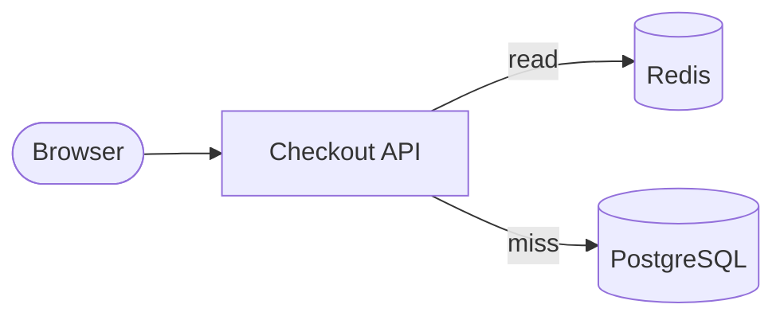

# Mermaid in repository docs

Syntax lives in `/ak:mermaidjs-v11`. This file covers how a Mermaid diagram
should look and behave inside a repository's Markdown.

## Placement

- Inline, directly under the paragraph that introduces it. A diagram the
  prose never mentions is noise.
- One question per diagram. Title it with the question or the subject in the
  sentence before the block, not with a heading made only for the diagram.
- A separate `.mmd` file only when two or more pages show the same diagram;
  then render it to `docs/diagrams/<slug>.svg` with
  `DIAG render <file.mmd> --out-dir docs/diagrams` and embed the SVG.

## Size and direction

- Up to ~20 nodes and ~25 edges. Beyond that, split by boundary or move to
  Archify and keep a small Mermaid overview that links to it.
- `flowchart LR` for architecture and data flow (reads left to right like a
  request); `flowchart TD` for processes and decisions.
- Node labels of one to four words; put detail in the surrounding prose or a
  table, not in the box.
- Node IDs in PascalCase or camelCase. Never a bare `end` node ID.
- Edge labels only where they add meaning (`|miss|`, `|async|`).

## Theme and color

- No `%%{init: {"theme": ...}}%%` and no hard-coded colors in docs: GitHub
  switches light/dark itself, and fixed colors break one of them.
- When a distinction matters (external vs internal), use shapes first
  (`[(database)]`, `([external])`, `{{queue}}`) and at most two `classDef`
  classes with readable contrast in both themes.

## Accessibility

- Every block gets `accTitle:` and `accDescr:` on the lines after the
  diagram type. GitHub exposes them to screen readers.
- The prose around the diagram must still state the key point; the diagram
  illustrates it, it does not replace it.

## GitHub compatibility

- GitHub renders `mermaid` fences natively but ships its own Mermaid version.
  Prefer long-supported types (`flowchart`, `sequenceDiagram`,
  `classDiagram`, `stateDiagram-v2`, `erDiagram`, `gantt`, `pie`, `mindmap`,
  `timeline`, `gitGraph`). `DIAG lint` warns on newer types such as
  `architecture-beta`; check the rendered page on GitHub before relying on
  them.
- No `click` callbacks or links to `javascript:`; GitHub strips them and they
  are unsafe in shared docs.
- Keep fences as ```` ```mermaid ```` (no attributes after the language) so
  GitHub, VS Code and docs generators all recognise them.

## Example


