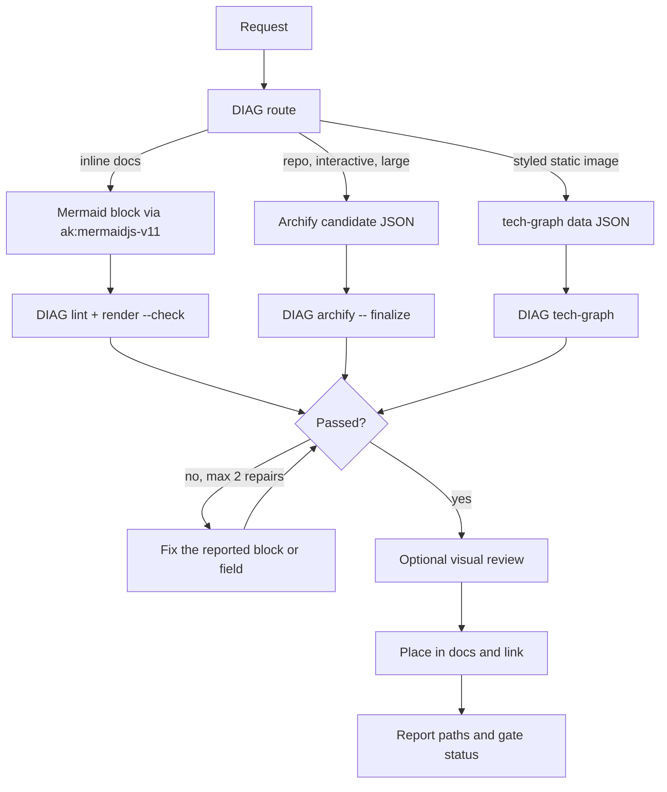
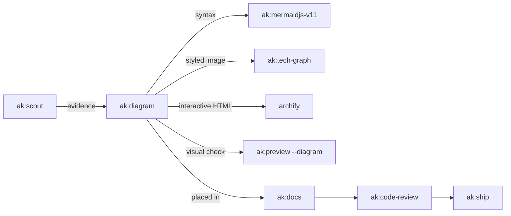

# Diagram workflow

Load this file for `--docs`, `--repo`, `--check`, `--pr`, or whenever a
diagram is part of a larger delivery. `DIAG` is the wrapper described in
`SKILL.md`.

## Contents

- [Single diagram](#single-diagram)
- [Repository-backed diagram](#repository-backed-diagram)
- [Documentation pass](#documentation-pass)
- [Check and CI](#check-and-ci)
- [Pull-request architecture delta](#pull-request-architecture-delta)
- [How it chains with other AgentKit skills](#how-it-chains-with-other-agentkit-skills)
- [Gates and evidence](#gates-and-evidence)

## Single diagram



1. `DIAG route "<request>" [--target ...] [--nodes N]` — accept its engine
   unless the user named one.
2. Collect the facts the diagram shows (user words, files, command output).
3. Author with the engine's own rules (see `SKILL.md` Step 3).
4. Validate with the engine's gate; at most two repair rounds.
5. Visual review only when asked or when the gate warns about layout.
6. Place it, then report.

## Repository-backed diagram

Use for "diagram this repo / service / module", onboarding maps and
architecture sections of a README.

1. Scope: name the question the diagram answers ("how does a request reach
   the database?"), the boundary (one service, one package) and the
   abstraction level (runtime components, not classes).
2. Evidence: run `/ak:scout` (or native search) over that boundary. Record,
   per component, the file or manifest that proves it exists, and per edge,
   the call site, config or queue name that proves it.
3. Engine: Archify `architecture` (or `dataflow` / `sequence`) with
   `--repo-root <repo>` so its source markers stay checkable. Without
   Archify, a Mermaid `flowchart LR` that keeps the same nodes and edges is
   the degraded path; say so.
4. Size: 8–12 core components, one primary path, external dependencies and
   trust boundaries. Push detail into Archify cards or a table under the
   Mermaid block rather than more edges.
5. Anything you could not prove from the repository is left out or drawn as
   an explicitly labelled assumption.

## Documentation pass

`/ak:diagram --docs [dir]` improves the diagrams of a docs tree.

1. Inventory: `DIAG scan <dir>` lists Markdown files with Mermaid blocks,
   `.mmd` files, Archify sources and tech-graph sources.
2. Health: `DIAG lint` on every file from the inventory, then
   `DIAG render --check` on the ones that passed lint. Broken diagrams are
   fixed first; they are worse than none.
3. Gaps: read the pages that explain a system, flow, schema or state machine
   in prose only. Propose at most one diagram per question; a page that is
   already clear without one gets none.
4. Plan table, shown to the user before writing more than three diagrams:

   | Page | Question the diagram answers | Kind | Engine | New or fix |
   | --- | --- | --- | --- | --- |

5. Author each diagram with the single-diagram workflow. Keep Mermaid inline
   next to the prose it explains; put Archify output in
   `docs/diagrams/<slug>/` and link it from the page together with a small
   Mermaid overview so the page still reads on GitHub.
6. Re-run lint and `render --check` over the touched files and report the
   per-file results.

## Check and CI

`/ak:diagram --check [path]` is read-only.

```bash
DIAG scan docs
DIAG lint README.md docs/*.md
DIAG render README.md docs/*.md --check
```

`lint` needs no network. `render --check` needs the pinned mermaid-cli and a
Chromium-family browser. When the CLI is not installed, `render` stops with
`BLOCKED` instead of downloading; with the user's agreement (or in CI, where
the workflow file is that agreement) add `--allow-download`, or install
`@mermaid-js/mermaid-cli` at the pinned version first. In CI, set
`AK_DIAGRAM_BROWSER` to the runner's Chrome to avoid a second browser
download. `scan` exits `1` with `complete: false` when it could not read part
of the tree; fix access before trusting the inventory. Archify sources are
checked by re-running their `finalize` command into a review folder; never
overwrite a committed HTML just to check it.

## Pull-request architecture delta

For "what changed in the architecture in this PR":

1. Build or update the Archify architecture JSON on the base and on the head
   (same IDs for unchanged components).
2. `DIAG archify -- compare architecture base.json head.json delta.html --json`
3. Link the delta page in the PR description with a two-line summary of the
   authored changes. The delta shows authored facts only; it does not prove
   impact, risk or merge safety, so do not claim those.

## How it chains with other AgentKit skills



- `/ak:plan` and `/ak:docs` may call `/ak:diagram` when a plan or doc needs a
  picture; `/ak:diagram` never edits those skills.
- `/ak:excalidraw` stays the choice for a hand-drawn whiteboard sketch.
- `/ak:render` stays the choice for report pages; a Mermaid block is not a
  report.

## Gates and evidence

| Engine | Gate | Proves | Does not prove |
| --- | --- | --- | --- |
| Mermaid | `DIAG lint` | known type, no unsafe content, fence closed | that it parses |
| Mermaid | `DIAG render --check` | the pinned mermaid-cli parses and renders it | how GitHub's own Mermaid version renders it |
| Archify | `finalize` receipt | schema, delivery, provenance and browser checks | perceptual layout quality unless captures were reviewed |
| tech-graph | `DIAG tech-graph` steps | generator ran, SVG shape, rsvg parse when available | visual collisions; review the PNG |

Report each gate as `PASS`, `FAIL`, `NOT_RUN` (with the reason) or
`BLOCKED`. A diagram whose gate did not run is not "verified".
