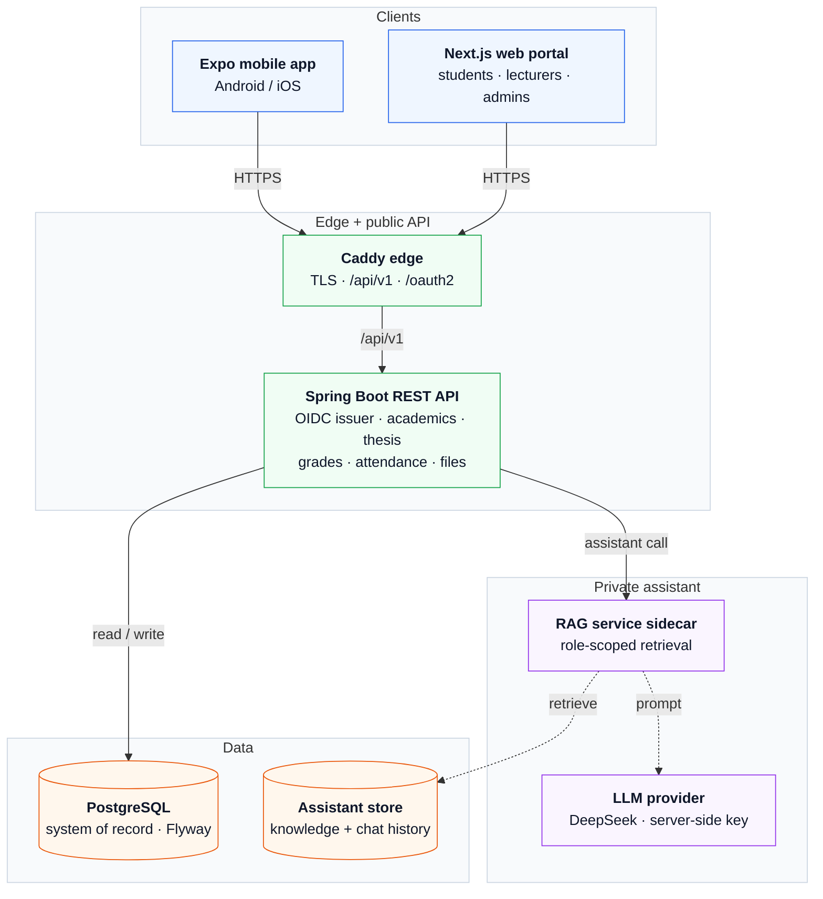
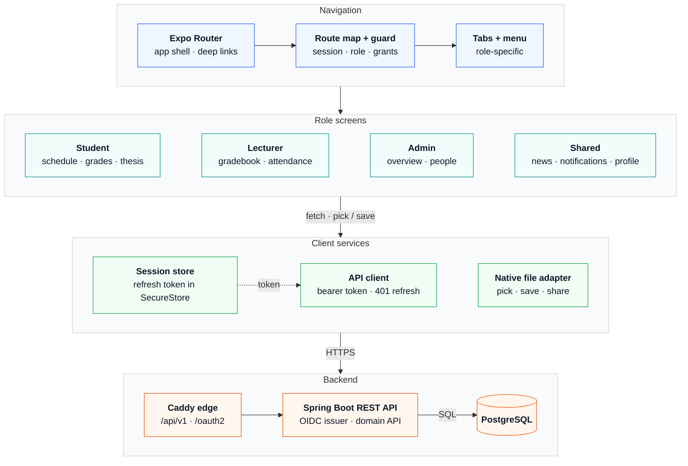
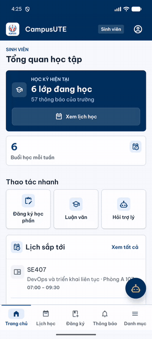
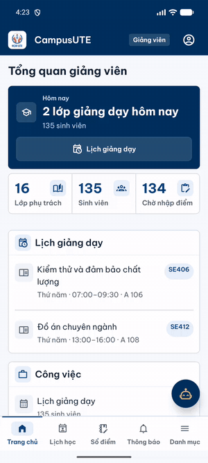
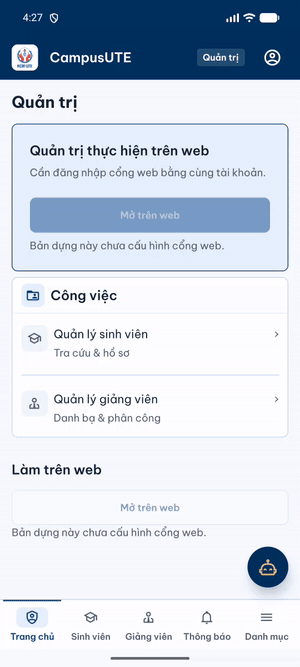

# CampusCore — Academic Information & Management Portal (local-first)

CampusCore is a **local-first web + mobile ecosystem workspace** for a bilingual (Vietnamese/English)
university: a Spring Boot REST API, a Next.js portal, PostgreSQL managed by Flyway, a private RAG
sidecar, and an Expo app.

> **Status: production deferred.** This workspace runs locally only (Docker Compose + Android
> emulator). Ecosystem hosts, DNS, signing, and stores are the owner's later decision — **nothing in
> this repository is deployed**. The production web project (`www.campusute.io.vn` with its own
> Render/Vercel/Neon stack) lives in **the main web project repository** and is not managed here
> (older docs in this repository referenced `JasonTM17/Student_Management_UTE`).

## Architecture

```
Next.js Web Portal (:3000) ────┐
                               ├───► Spring Boot REST API (:4010) ───► PostgreSQL 15 (:5432)
Expo Mobile App (mobile/) ─────┘         │ /internal/rag (internal network)
                                         ▼
                                  rag-service sidecar (:4011, not host-published) ───► DeepSeek (optional)
```

**System**



**Mobile app**



- `java-services/restful-api` — Java 21 / Spring Boot 4.1.1: `/api/v1` REST API, OIDC issuer + BFF, Flyway.
- `frontend/` — Next.js 15 portal with a same-origin `/api/v1` proxy.
- `database/` — PostgreSQL 15; in Compose, `rag-service` runs migrations (`restful-api` sets `FLYWAY_ENABLED=false`).
- `mobile/` — Expo/React Native (expo-router, SecureStore), run on an Android emulator.
- `rag-service` — internal sidecar on port 4011, lexical RAG plus prompt-injection guard; DeepSeek is optional.

## Local quick start

Requirements: **Docker Desktop 24+** running, at least 4 GB RAM, and the local ports below free.
Add **Java 21 + Maven 3.9** only to run backend tests/the JAR outside Docker, **Node 20+** for the
Next.js frontend, and **Node 22.13+** for the Expo CLI/mobile app.

```powershell
git clone https://github.com/JasonTM17/CampusCore_Ecosystem.git
cd CampusCore_Ecosystem

# Start the local demo stack; the runner creates .env and checkout-specific secrets
node scripts/local-dev.mjs up
node scripts/local-dev.mjs status

# 3) Health probes (readiness key is generated in .env)
curl.exe http://127.0.0.1:4010/api/v1/health/liveness
$env:HEALTH_READINESS_KEY = ((Get-Content .env | Select-String '^HEALTH_READINESS_KEY=').Line -split '=', 2)[1]
curl.exe -H "X-Health-Key: $env:HEALTH_READINESS_KEY" http://127.0.0.1:4010/api/v1/health/readiness

# 4) OpenAPI contract
curl.exe http://127.0.0.1:4010/v3/api-docs
```

| Component | Local port / address | `.env` override |
| --- | --- | --- |
| Web portal (Compose or `npm run dev` in `frontend/`) | `http://127.0.0.1:3000` | `FRONTEND_HOST_PORT` |
| REST API (host) | `http://127.0.0.1:4010` | `RESTFUL_API_HOST_PORT` |
| Swagger UI | `http://127.0.0.1:4010/swagger-ui.html` | — |
| PostgreSQL | `127.0.0.1:5432` · DB `campuscore_restful` · user `campuscore` | `POSTGRES_HOST_PORT`, `POSTGRES_*` |
| Mailpit | UI `http://127.0.0.1:8025` · SMTP `127.0.0.1:1025` | `MAILPIT_UI_HOST_PORT`, `MAILPIT_SMTP_HOST_PORT` |
| rag-service | `:4011`, Compose network only | — |
| E2E (`docker-compose.e2e.yml` + `scripts/run-course-e2e.mjs`) | web `3101` · API `4100` · Postgres `5433` | `E2E_API_HOST_PORT`, `POSTGRES_HOST_PORT` |
| SSO preview (`docker-compose.sso-preview.yml`) | web `3102` · identity TLS `4443` | — |

If `5432` or `3000` is taken, set `POSTGRES_HOST_PORT` / `FRONTEND_HOST_PORT` in `.env`
(for example `5434` / `3001`) and start Compose again; an API outside Docker must point
`SPRING_DATASOURCE_URL` at the new Postgres port. E2E and SSO preview are separate test stacks and
are not needed for the quick start.
`local-dev up` selects `docker-compose.local.yml` and generates missing Compose
secrets in the git-ignored `.env`. Running `docker-compose.yml` alone requires
explicit secret values and keeps demos disabled.

### Running the API outside Docker

Needs **Java 21** (matching `maven.compiler.release=21` in `java-services/pom.xml` and the
`eclipse-temurin:21` Dockerfile image) and a running PostgreSQL 15. The `persistence` profile is
required: the datasource, Flyway and `DemoAccountGate` only work under it.

```powershell
# PostgreSQL: the Compose container (POSTGRES_HOST_PORT) or a host installation
node scripts/compose-secrets.mjs --ensure
docker compose -f docker-compose.yml -f docker-compose.local.yml up -d postgres

# Minimum variables (set them in the shell that runs Maven)
$env:SPRING_PROFILES_ACTIVE = "persistence"
$env:JWT_SECRET = "<32+-random-chars>"            # JwtSecretPolicy requires >= 32 characters
$env:JWT_REFRESH_SECRET = "<another-32+-value>"   # also >= 32 characters and different from JWT_SECRET
$env:ASSISTANT_RAG_OWNER_ASSERTION_SECRET = "<generated-dedicated-key>" # when sidecar RAG is enabled
$env:SPRING_DATASOURCE_URL = "jdbc:postgresql://localhost:5432/campuscore_restful"
$env:SPRING_DATASOURCE_USERNAME = "campuscore"
$env:SPRING_DATASOURCE_PASSWORD = "<POSTGRES_PASSWORD from .env>"
$env:DEMO_ACCOUNTS_ENABLED = "true"               # YAML default false locks every demo account
$env:HEALTH_READINESS_KEY = "<HEALTH_READINESS_KEY from .env>"

# Assistant RLS: Flyway V84 creates campuscore_assistant_runtime as NOLOGIN;
# run the one-shot provisioning before the API migrates/starts.
$env:ASSISTANT_DB_PASSWORD = "<ASSISTANT_DB_PASSWORD from .env>"   # >= 16 characters
node scripts/provision-assistant-runtime.mjs

# Run the API; Flyway is on by default (FLYWAY_ENABLED=true) outside Compose
mvn -f java-services/pom.xml -pl restful-api spring-boot:run
```

Generate secrets with `openssl rand -base64 48`. Or build the JAR and run it:
`mvn -f java-services/pom.xml -pl restful-api package -DskipTests` and
`java -jar java-services/restful-api/target/campuscore-restful-api-*.jar`.
Skipping provisioning still boots the API, but the assistant returns 503 (RLS pool degraded).

### Demo accounts

`local-dev up` selects the overlay that enables demo accounts and quick-fill; base Compose keeps
demos disabled. Primary accounts: `student@campuscore.edu`, `lecturer@campuscore.edu`,
`admin@campuscore.edu` (seeded password `password123`, local only). Full list, account-lock policy,
and the demo script: [docs/DEMO_RUNBOOK.md](docs/DEMO_RUNBOOK.md). Run the base Compose file directly
with explicit secrets to keep demo accounts disabled.

### Mobile app (Android emulator)

Start the local stack with the mobile OIDC overlay (Android emulator targets `http://10.0.2.2:4010`):

```powershell
# Start mobile overlay and verify OIDC flow end-to-end without a browser
node scripts/local-dev.mjs up --mobile
node scripts/mobile-local-oidc-verify.mjs

# Run the Expo mobile app
cd mobile
Copy-Item .env.example .env   # keep the local values after copying
npm start
```

On Windows, if database host port `5432` is reserved, override it with `POSTGRES_HOST_PORT` in `.env` (e.g. `55432`).
Prerequisites and release signing: [mobile/README.md](mobile/README.md).

Real screens and GIFs from the Android emulator (live data from the local stack, OIDC sign-in):

| Student | Lecturer | Admin |
| :---: | :---: | :---: |
|  |  |  |

Full per-role tour, offline behaviour and how the media were captured: [docs/MOBILE_APP_TOUR.md](docs/MOBILE_APP_TOUR.md) (Vietnamese).

## Testing

Frontend/mobile commands need dependencies installed once (`npm ci`) in the matching directory.

```powershell
# Backend (Java 21)
mvn -q -f java-services/pom.xml verify
mvn test -f java-services/pom.xml -Dtest=AcademicEnrollmentMutationPersistenceTest

# Frontend
npm test --prefix frontend
npm run typecheck --prefix frontend
npm run lint --prefix frontend
npm run build --prefix frontend

# Mobile
npm test --prefix mobile
npm run typecheck --prefix mobile
```

## Documentation

- [docs/ecosystem/README.md](docs/ecosystem/README.md) — task-based ecosystem documentation index.
- [docs/ARCHITECTURE.md](docs/ARCHITECTURE.md) — runtime boundaries, concurrency invariants, non-goals.
- [docs/DEMO_RUNBOOK.md](docs/DEMO_RUNBOOK.md) — local demo/evaluation script.
- [docs/RELEASE.md](docs/RELEASE.md) — local candidate release checklist (does not authorize deployment).
- [docs/security/authorization-model.md](docs/security/authorization-model.md) — authorization model.
- [docs/integrations/deepseek-assistant.md](docs/integrations/deepseek-assistant.md) — assistant configuration.
- [docs/ecosystem/environment.md](docs/ecosystem/environment.md) — runtime environment inventory.
- [README.vi.md](README.vi.md) — Vietnamese documentation.

---

*CampusCore Student & Academic Management System — Faculty of Information Technology, HCMUTE.*
