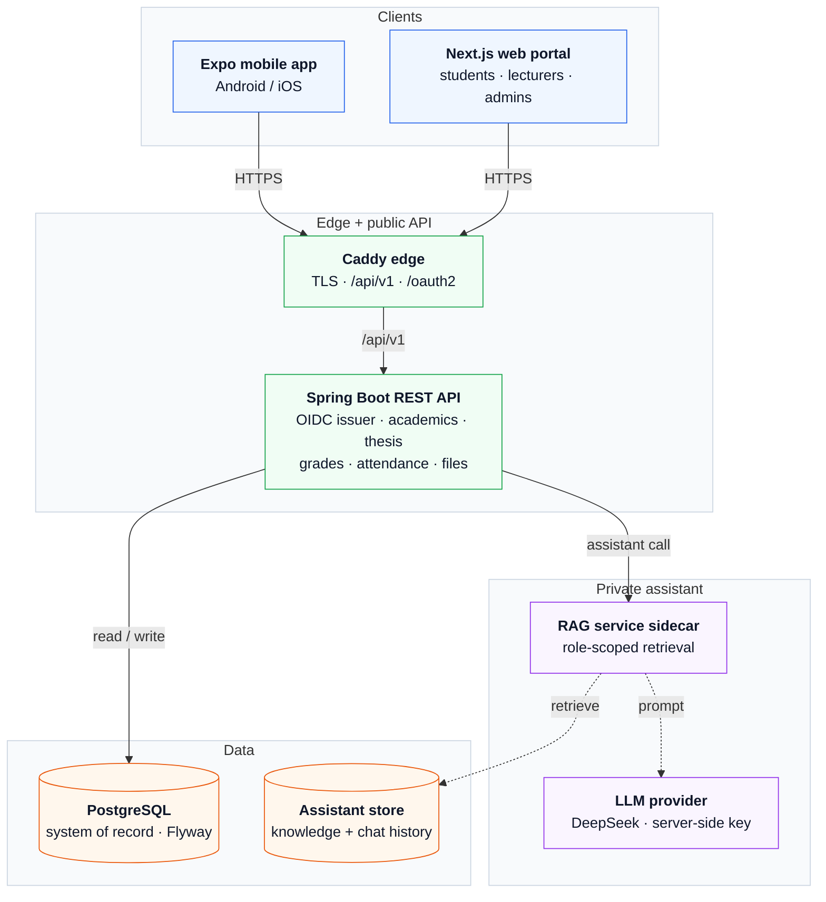
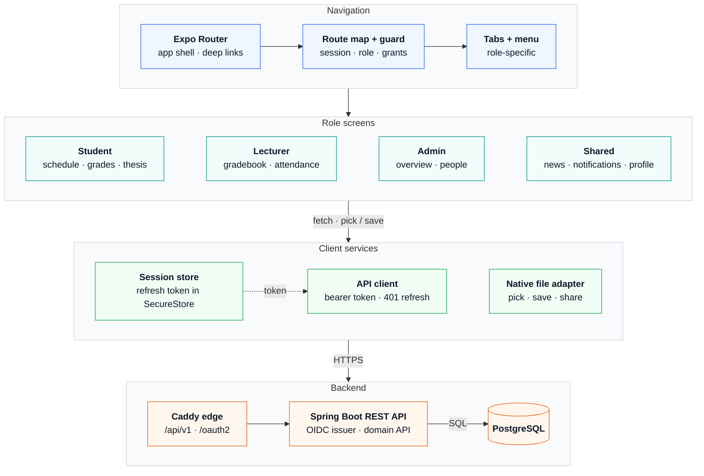
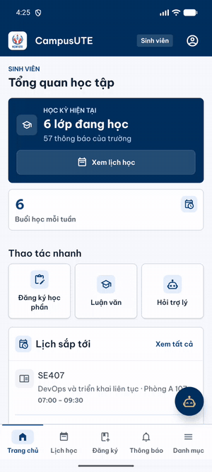
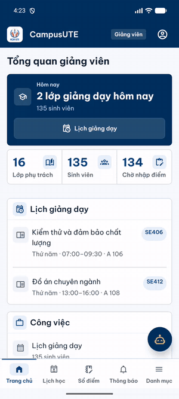
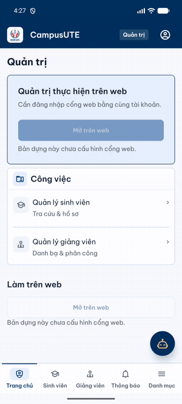

# CampusCore — Cổng Thông Tin Đào Tạo & Quản Lý Học Vụ (local-first)

CampusCore là **ecosystem workspace** phát triển **web + mobile local-first** cho một trường đại học
song ngữ (Việt/Anh): một Spring Boot REST API, một Next.js portal, PostgreSQL quản lý bằng Flyway,
một RAG sidecar nội bộ và một app Expo.

> **Trạng thái: production deferred.** Workspace này chỉ chạy local (Docker Compose + Android emulator).
> Host, DNS, signing và store của ecosystem sẽ do chủ dự án quyết định sau — **không có gì trong repo
> này đang được deploy**. Dự án web production (`www.campusute.io.vn` với stack Render/Vercel/Neon của
> nó) nằm ở **repository chính của dự án web** và không được quản lý ở đây (tài liệu cũ trong repo này
> từng nhắc `JasonTM17/Student_Management_UTE`).

## Kiến trúc

```
Next.js Web Portal (:3000) ────┐
                               ├───► Spring Boot REST API (:4010) ───► PostgreSQL 15 (:5432)
Expo Mobile App (mobile/) ─────┘         │ /internal/rag (mạng nội bộ)
                                         ▼
                                  rag-service sidecar (:4011, không publish host) ───► DeepSeek (tùy chọn)
```

**Hệ thống**



**Ứng dụng di động**



- `java-services/restful-api` — Java 21 / Spring Boot 4.1.1: REST API `/api/v1`, OIDC issuer + BFF, Flyway.
- `frontend/` — Next.js 15 portal, proxy cùng nguồn `/api/v1`.
- `database/` — PostgreSQL 15; trong compose, `rag-service` chạy migration (`restful-api` đặt `FLYWAY_ENABLED=false`).
- `mobile/` — Expo/React Native (expo-router, SecureStore), chạy trên Android emulator.
- `rag-service` — sidecar nội bộ cổng 4011, lexical RAG + prompt-injection guard; DeepSeek là tùy chọn.

## Quick start (local)

Yêu cầu: **Docker Desktop 24+** đang chạy, tối thiểu 4 GB RAM, và các cổng của cụm local bên dưới
đang trống. Chỉ cần thêm **Java 21 + Maven 3.9** khi chạy test/jar ngoài Docker, **Node 20+** cho
frontend Next.js, và **Node 22.13+** cho Expo CLI/app mobile.

```powershell
git clone https://github.com/JasonTM17/CampusCore_Ecosystem.git
cd CampusCore_Ecosystem

# Khởi động cụm demo local; runner tạo .env và secret riêng cho checkout
node scripts/local-dev.mjs up
node scripts/local-dev.mjs status

# 3) Health probes (khóa readiness được tạo trong .env)
curl.exe http://127.0.0.1:4010/api/v1/health/liveness
$env:HEALTH_READINESS_KEY = ((Get-Content .env | Select-String '^HEALTH_READINESS_KEY=').Line -split '=', 2)[1]
curl.exe -H "X-Health-Key: $env:HEALTH_READINESS_KEY" http://127.0.0.1:4010/api/v1/health/readiness

# 4) Hợp đồng OpenAPI
curl.exe http://127.0.0.1:4010/v3/api-docs
```

| Thành phần | Cổng / địa chỉ local | Ghi đè trong `.env` |
| --- | --- | --- |
| Web portal (compose hoặc `npm run dev` trong `frontend/`) | `http://127.0.0.1:3000` | `FRONTEND_HOST_PORT` |
| REST API (host) | `http://127.0.0.1:4010` | `RESTFUL_API_HOST_PORT` |
| Swagger UI | `http://127.0.0.1:4010/swagger-ui.html` | — |
| PostgreSQL | `127.0.0.1:5432` · DB `campuscore_restful` · user `campuscore` | `POSTGRES_HOST_PORT`, `POSTGRES_*` |
| Mailpit | UI `http://127.0.0.1:8025` · SMTP `127.0.0.1:1025` | `MAILPIT_UI_HOST_PORT`, `MAILPIT_SMTP_HOST_PORT` |
| rag-service | `:4011`, chỉ trong mạng compose | — |
| E2E (`docker-compose.e2e.yml` + `scripts/run-course-e2e.mjs`) | web `3101` · API `4100` · Postgres `5433` | `E2E_API_HOST_PORT`, `POSTGRES_HOST_PORT` |
| SSO preview (`docker-compose.sso-preview.yml`) | web `3102` · TLS identity `4443` | — |

Nếu `5432` hoặc `3000` đã bị chiếm, đặt `POSTGRES_HOST_PORT` / `FRONTEND_HOST_PORT` trong `.env`
(ví dụ `5434` / `3001`) rồi chạy lại compose; API ngoài Docker phải trỏ `SPRING_DATASOURCE_URL`
vào cổng Postgres mới. E2E và SSO preview là stack kiểm thử riêng, không cần cho quick start.
`local-dev up` chọn `docker-compose.local.yml` và tạo các secret Compose còn thiếu
trong `.env` bị Git bỏ qua. Chạy riêng `docker-compose.yml` yêu cầu tự cung cấp
các secret và giữ demo tắt.

### Chạy API ngoài Docker

Cần **Java 21** (khớp `maven.compiler.release=21` trong `java-services/pom.xml` và image
`eclipse-temurin:21` của Dockerfile) cùng PostgreSQL 15 đang chạy. Profile `persistence` là bắt buộc:
datasource, Flyway và `DemoAccountGate` chỉ hoạt động trong profile này.

```powershell
# PostgreSQL: dùng container compose (cổng POSTGRES_HOST_PORT) hoặc PostgreSQL cài sẵn
node scripts/compose-secrets.mjs --ensure
docker compose -f docker-compose.yml -f docker-compose.local.yml up -d postgres

# Biến tối thiểu (đặt trong shell đang chạy Maven)
$env:SPRING_PROFILES_ACTIVE = "persistence"
$env:JWT_SECRET = "<32+-random-chars>"            # JwtSecretPolicy yêu cầu >= 32 ký tự
$env:JWT_REFRESH_SECRET = "<another-32+-value>"   # cũng >= 32 ký tự và khác JWT_SECRET
$env:ASSISTANT_RAG_OWNER_ASSERTION_SECRET = "<generated-dedicated-key>" # khi bật sidecar RAG
$env:SPRING_DATASOURCE_URL = "jdbc:postgresql://localhost:5432/campuscore_restful"
$env:SPRING_DATASOURCE_USERNAME = "campuscore"
$env:SPRING_DATASOURCE_PASSWORD = "<POSTGRES_PASSWORD trong .env>"
$env:DEMO_ACCOUNTS_ENABLED = "true"               # YAML mặc định false = khoá mọi tài khoản demo
$env:HEALTH_READINESS_KEY = "<giá trị HEALTH_READINESS_KEY trong .env>"

# Assistant RLS: Flyway V84 tạo role campuscore_assistant_runtime ở trạng thái NOLOGIN;
# chạy provisioning một lần trước khi API migrate/khởi động.
$env:ASSISTANT_DB_PASSWORD = "<giá trị ASSISTANT_DB_PASSWORD trong .env>"   # >= 16 ký tự
node scripts/provision-assistant-runtime.mjs

# Chạy API; Flyway bật mặc định (FLYWAY_ENABLED=true) khi ngoài compose
mvn -f java-services/pom.xml -pl restful-api spring-boot:run
```

Tạo secret bằng `openssl rand -base64 48`. Hoặc build jar rồi chạy:
`mvn -f java-services/pom.xml -pl restful-api package -DskipTests` và
`java -jar java-services/restful-api/target/campuscore-restful-api-*.jar`.
Bỏ qua bước provisioning thì API vẫn boot nhưng trợ lý trả 503 (RLS pool degraded).

### Tài khoản demo

`local-dev up` chọn overlay bật `DEMO_ACCOUNTS_ENABLED` và quick-fill cho cụm local;
base Compose giữ demo tắt. Ba tài khoản chính: `student@campuscore.edu`, `lecturer@campuscore.edu`, `admin@campuscore.edu`
(mật khẩu seed `password123`, chỉ dùng cho local). Danh sách đầy đủ, chính sách khoá tài khoản và
kịch bản demo: [docs/DEMO_RUNBOOK.md](docs/DEMO_RUNBOOK.md). Dùng base Compose trực tiếp với secret values để giữ demo tắt.

### App mobile (Android emulator)

Khởi động cụm local kèm OIDC cho mobile (Android emulator trỏ `http://10.0.2.2:4010`):

```powershell
# Bật overlay mobile và kiểm tra luồng OIDC không cần trình duyệt
node scripts/local-dev.mjs up --mobile
node scripts/mobile-local-oidc-verify.mjs

# Chạy app mobile (Expo)
cd mobile
Copy-Item .env.example .env   # giữ nguyên các giá trị local sau khi copy
npm start
```

Trên Windows, nếu cổng cơ sở dữ liệu `5432` bị dịch vụ hệ thống chiếm dụng, đặt `POSTGRES_HOST_PORT` trong `.env` (ví dụ `55432`).
Yêu cầu môi trường và build release signing: [mobile/README.md](mobile/README.md).

Ảnh và GIF thật từ Android emulator (dữ liệu thật của cụm local, đăng nhập OIDC):

| Sinh viên | Giảng viên | Quản trị |
| :---: | :---: | :---: |
|  |  |  |

Tour đầy đủ từng vai trò, hành vi khi mất mạng và cách quay lại ảnh/GIF: [docs/MOBILE_APP_TOUR.md](docs/MOBILE_APP_TOUR.md).

## Kiểm thử

Các lệnh frontend/mobile cần cài dependency một lần (`npm ci`) trong thư mục tương ứng.

```powershell
# Backend (Java 21)
mvn -q -f java-services/pom.xml verify
mvn test -f java-services/pom.xml -Dtest=AcademicEnrollmentMutationPersistenceTest

# Frontend
npm test --prefix frontend
npm run typecheck --prefix frontend
npm run lint --prefix frontend
npm run build --prefix frontend

# Mobile
npm test --prefix mobile
npm run typecheck --prefix mobile
```

## Tài liệu

- [docs/ecosystem/README.md](docs/ecosystem/README.md) — mục lục tài liệu ecosystem theo tác vụ.
- [docs/ARCHITECTURE.md](docs/ARCHITECTURE.md) — ranh giới runtime, bất biến đồng thời, non-goals.
- [docs/DEMO_RUNBOOK.md](docs/DEMO_RUNBOOK.md) — kịch bản demo/thẩm định trên cụm local.
- [docs/RELEASE.md](docs/RELEASE.md) — checklist phát hành candidate local (không cấp quyền deploy).
- [docs/security/authorization-model.md](docs/security/authorization-model.md) — mô hình phân quyền.
- [docs/integrations/deepseek-assistant.md](docs/integrations/deepseek-assistant.md) — cấu hình trợ lý AI.
- [docs/ecosystem/environment.md](docs/ecosystem/environment.md) — inventory biến môi trường.
- [README.en.md](README.en.md) — bản tiếng Anh.

---

*Đồ án Quản lý Sinh viên & Học vụ CampusCore — Khoa Công nghệ Thông tin, HCMUTE.*
