# CampusUTE Mobile — Tour ứng dụng

Tài liệu này giới thiệu app **CampusUTE** (Expo + React Native + TypeScript) bằng ảnh chụp và GIF
quay từ Android emulator chạy **dữ liệu thật** của cụm local (Docker Compose + OIDC), không phải bản mock.
Mọi ảnh/GIF nằm trong [`docs/assets/mobile`](assets/mobile); cách tạo lại ở [mục 8](#8-tạo-lại-ảnh-và-gif).

> **Phạm vi bằng chứng.** Ảnh và GIF được quay trên emulator Android x86_64 (1080 × 2400), bản release
> `local` dựng từ commit `2e4b40e4` (mã mobile giống hệt `main` sau PR #5), nối với API `http://10.0.2.2:4010`.
> Chưa có phép thử trên thiết bị thật. Xem [Giới hạn đã biết](#9-giới-hạn-đã-biết).

## Mục lục

1. [Tổng quan](#1-tổng-quan)
2. [Chạy nhanh](#2-chạy-nhanh)
3. [Sinh viên](#3-sinh-viên)
4. [Giảng viên](#4-giảng-viên)
5. [Quản trị](#5-quản-trị)
6. [Mất mạng khi mở app](#6-mất-mạng-khi-mở-app)
7. [Chất lượng và bằng chứng](#7-chất-lượng-và-bằng-chứng)
8. [Tạo lại ảnh và GIF](#8-tạo-lại-ảnh-và-gif)
9. [Giới hạn đã biết](#9-giới-hạn-đã-biết)

## 1. Tổng quan

| Hạng mục | Giá trị |
| --- | --- |
| Công nghệ | Expo (expo-router), React Native, TypeScript, SecureStore |
| Số màn hình đã đăng ký | 59 (xem [Screen atlas](../mobile/README.md#screen-atlas)) |
| Vai trò | Sinh viên, Giảng viên, Quản trị, Thí sinh xét tuyển (chỉ khu vực tuyển sinh) |
| Ngôn ngữ | Tiếng Việt (mặc định) và tiếng Anh, danh mục chuỗi có kiểm tra song song vi/en |
| Giao diện | Một nguồn token (`contracts/ecosystem/tokens.json`), sáng/tối theo hệ thống |
| Đăng nhập | OIDC qua trình duyệt trong app (Chrome Custom Tab), token lưu trong SecureStore |
| Bố cục | Ba lớp cửa sổ: compact, medium (≥ 600 dp), expanded (≥ 840 dp); danh sách đổi số cột theo lớp |
| Trợ năng | Vùng chạm ≥ 44 dp, nhãn TalkBack cho nút chỉ có biểu tượng, ảnh trang trí được ẩn, hỗ trợ cỡ chữ 2.0× |

Thanh điều hướng dưới cùng theo vai trò; menu **Danh mục** chỉ liệt kê các tuyến mà vai trò đó được phép,
và điều hướng trực tiếp tới tuyến không được phép sẽ bị chặn.

| Vai trò | Thanh điều hướng |
| --- | --- |
| Sinh viên | Trang chủ · Lịch học · Đăng ký · Thông báo · Danh mục |
| Giảng viên | Trang chủ · Lịch học · Sổ điểm · Thông báo · Danh mục |
| Quản trị | Trang chủ · Sinh viên · Giảng viên · Thông báo · Danh mục |

## 2. Chạy nhanh

Yêu cầu: Docker Desktop, Node 22.13+, Android Studio (emulator). Từ thư mục gốc của repo:

```powershell
# Cụm local kèm overlay mobile (API 4010, Web 3000, Mailpit 8025)
node scripts/local-dev.mjs up --mobile
node scripts/mobile-local-oidc-verify.mjs      # kiểm tra OIDC end-to-end, không cần trình duyệt

# Mobile
cd mobile
Copy-Item .env.example .env
npm ci
npm start
```

Tài khoản demo (mật khẩu seed `password123`, chỉ dùng cho local; danh sách đầy đủ ở
[DEMO_RUNBOOK](DEMO_RUNBOOK.md)):

| Vai trò | Email |
| --- | --- |
| Sinh viên | `student@campuscore.edu` |
| Giảng viên | `lecturer@campuscore.edu` |
| Quản trị | `admin@campuscore.edu` |

Trên Windows, nếu cổng `5432` bị dịch vụ hệ thống chiếm, đặt `POSTGRES_HOST_PORT` (ví dụ `55432`)
trong `.env` hoặc biến môi trường trước khi chạy `local-dev`.

## 3. Sinh viên

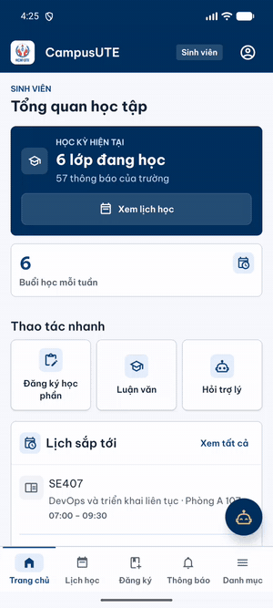

| Tổng quan học tập | Lịch học | Đăng ký học phần | Thông báo | Danh mục |
| :---: | :---: | :---: | :---: | :---: |
| 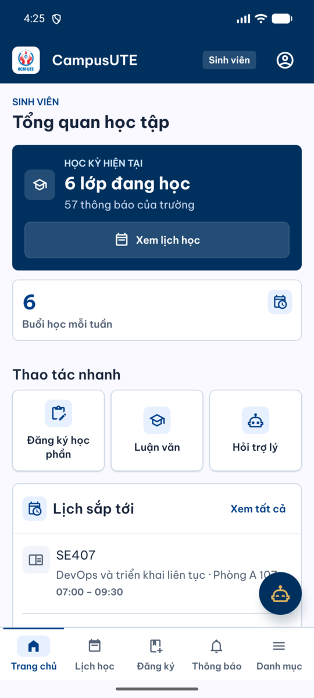 | 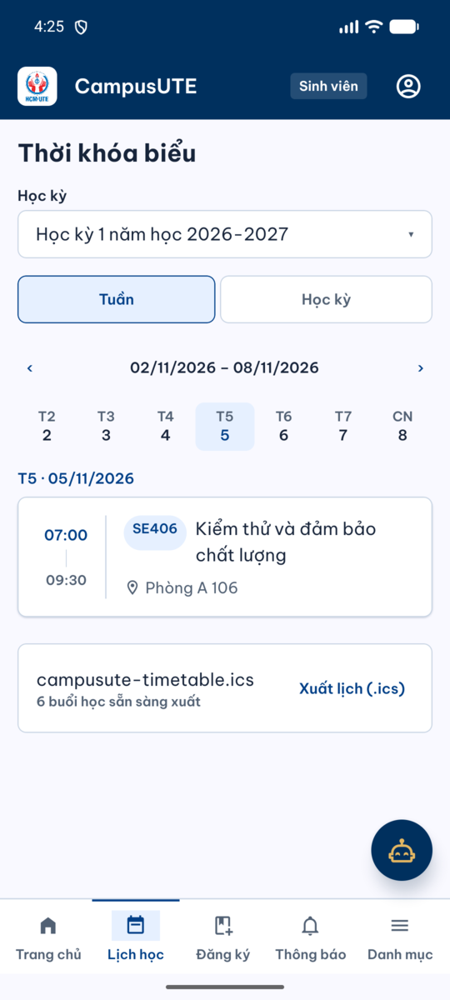 | 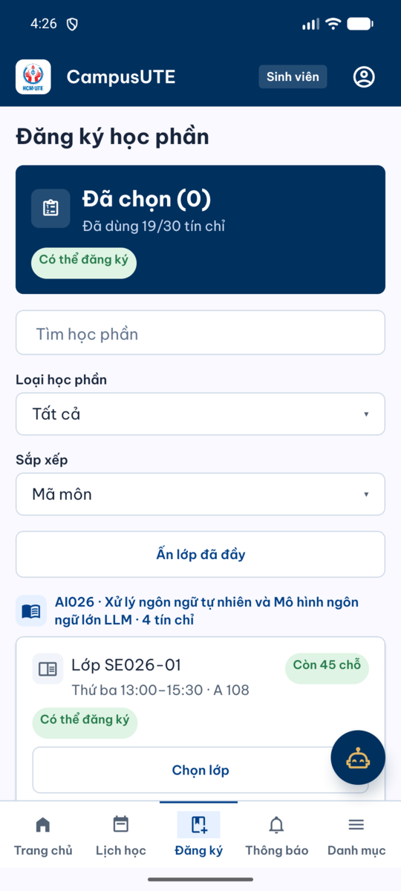 | 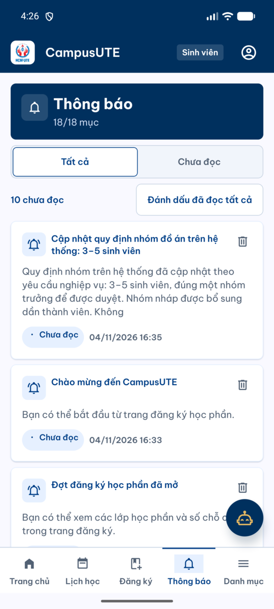 | 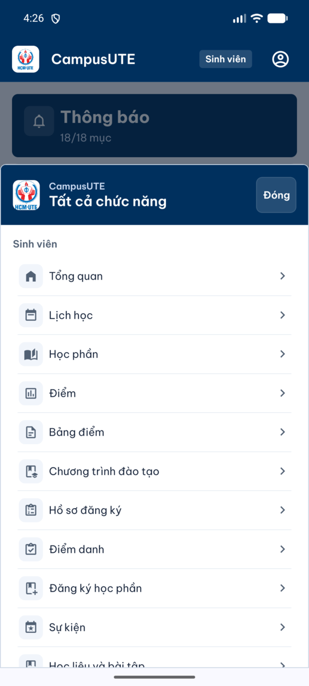 |

- **Tổng quan**: học kỳ hiện tại, số lớp đang học, buổi học mỗi tuần, thao tác nhanh (đăng ký học phần,
  luận văn, hỏi trợ lý) và lịch sắp tới.
- **Đăng ký học phần**: giỏ đăng ký, số tín chỉ đã dùng so với hạn mức, tìm kiếm, lọc loại học phần,
  sắp xếp, ẩn lớp đã đầy; mỗi lớp hiển thị chỗ còn lại và trạng thái có thể đăng ký.
- **Danh mục** gom các chức năng còn lại: học phần, điểm, bảng điểm, chương trình đào tạo, hồ sơ đăng ký,
  điểm danh (check-in theo vị trí), sự kiện, học liệu và bài tập, tuyển sinh, thư viện, việc làm, tin tức,
  luận văn và trợ lý CampusUTE.

## 4. Giảng viên

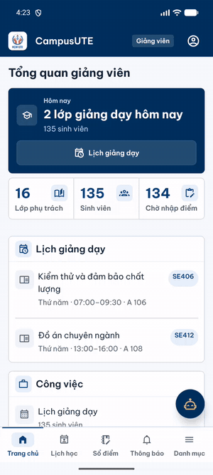

| Tổng quan giảng viên | Lịch giảng dạy | Bảng điểm | Thông báo | Danh mục |
| :---: | :---: | :---: | :---: | :---: |
| 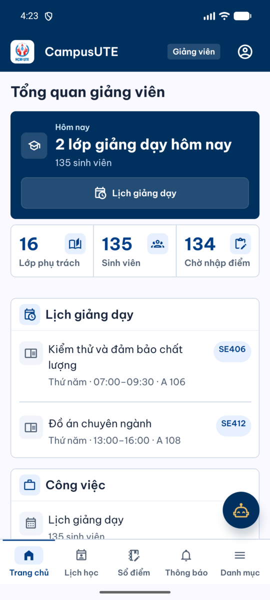 | 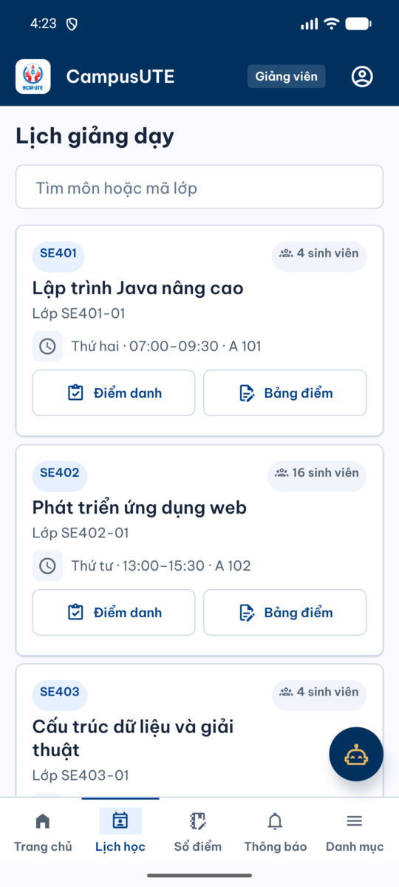 | 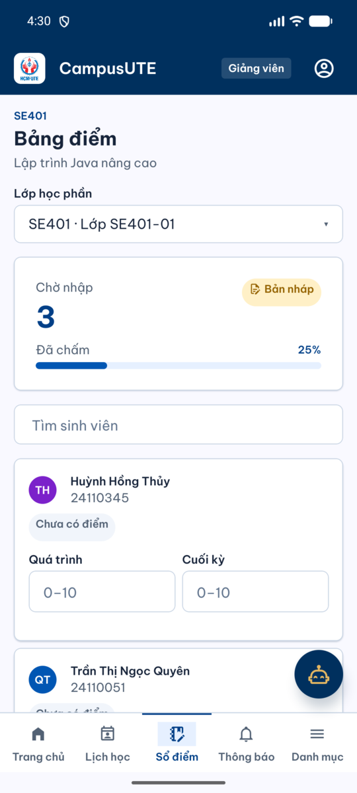 | 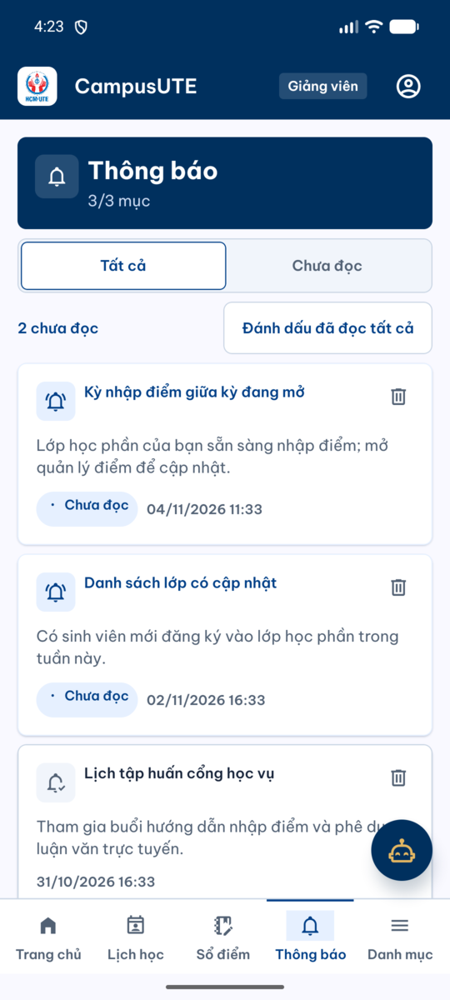 | 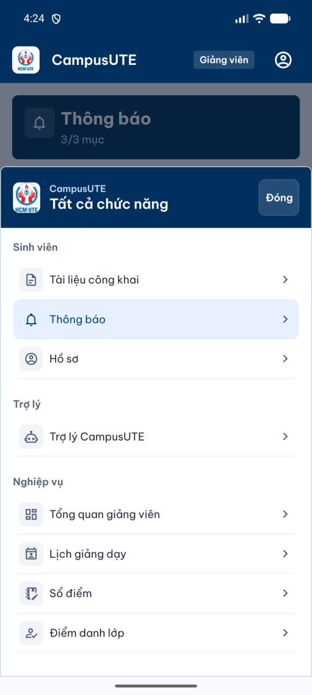 |

- **Tổng quan**: lớp dạy hôm nay, số lớp phụ trách, tổng sinh viên và số bài chờ nhập điểm.
- **Lịch giảng dạy**: tìm theo tên môn hoặc mã lớp; mỗi lớp có lối tắt **Điểm danh** và **Bảng điểm**.
- **Bảng điểm**: thẻ tóm tắt tiến độ chấm (bản nháp), tìm sinh viên, nhập điểm quá trình và cuối kỳ.
  Khoảng cách giữa thẻ tóm tắt và ô tìm kiếm là một lỗi bố cục thật đã được sửa trong đợt này
  (các khối liền kề giờ cách nhau ít nhất `tokens.spacing.xs`, có test render kiểm tra).

## 5. Quản trị

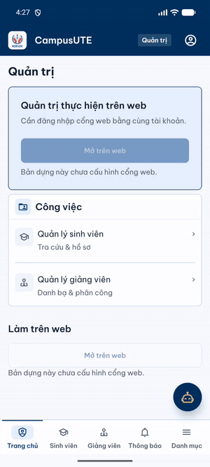

| Tổng quan quản trị | Sinh viên | Giảng viên | Thông báo | Danh mục |
| :---: | :---: | :---: | :---: | :---: |
|  | 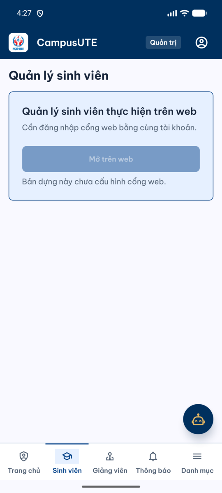 | 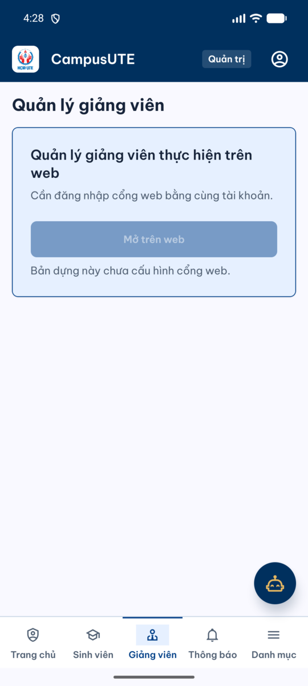 | 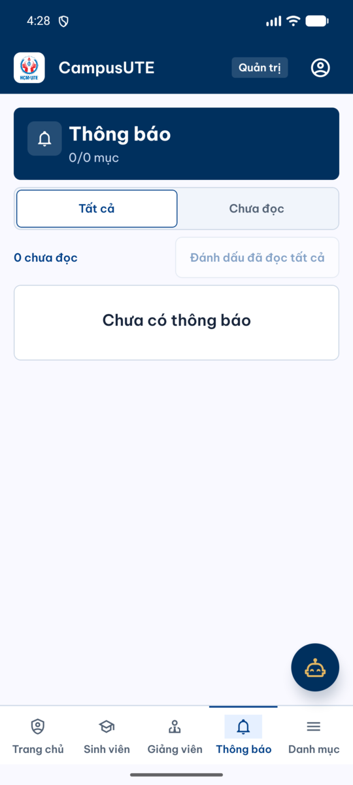 | 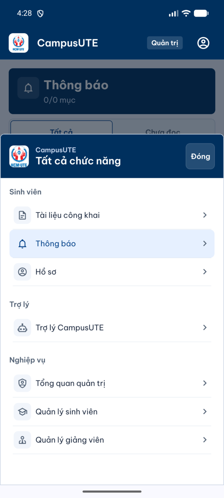 |

Vai trò quản trị trên mobile có chủ đích giới hạn: tra cứu hồ sơ và danh bạ, còn các thao tác quản trị
nặng được chuyển sang cổng web (nút **Mở trên web**). Trong bản `local` nút này bị tắt và hiển thị
"Bản dựng này chưa cấu hình cổng web", vì địa chỉ cổng web `https://portal.localhost:3102` là địa chỉ phía máy chủ
mà emulator không phân giải được.

## 6. Mất mạng khi mở app

Trước đây, mở app khi **không có mạng** với phiên đã lưu sẽ đẩy người dùng về màn hình đăng xuất và làm mất
credential, nên không thể xem lại dữ liệu đã tải. Nguyên nhân: refresh token của máy chủ chỉ dùng một lần,
nên app xoá credential **trước khi** gửi yêu cầu làm mới (để không bao giờ phát lại token có thể đã bị xoay),
và mọi lỗi mạng sau đó bị coi là phải đăng nhập lại.

Cách xử lý hiện tại giữ nguyên quy tắc an toàn đó và chỉ thêm một bước trước khi gửi:

1. Kiểm tra kết nối (`expo-network`). Nếu máy **chắc chắn offline** (`isConnected === false` hoặc
   `isInternetReachable === false`) thì **không gửi yêu cầu nào**, credential vẫn nằm nguyên trong kho an toàn.
2. Trạng thái khởi động là `unavailable` (lý do `offline`), không phải `signedOut` hay `reauthRequired`.
3. Khi kiểm tra kết nối lỗi hoặc không xác định, app tiến hành như trước (không chặn làm mới vì một phép dò chập chờn).
4. Yêu cầu đã thực sự được gửi mà thất bại vẫn giữ nguyên hành vi cũ: credential bị cách ly, kết quả là
   `reauthRequired`; `400/401` vẫn là `signedOut`.

| Mở app khi offline | Sau khi có mạng và bấm "Thử lại phiên" |
| :---: | :---: |
| 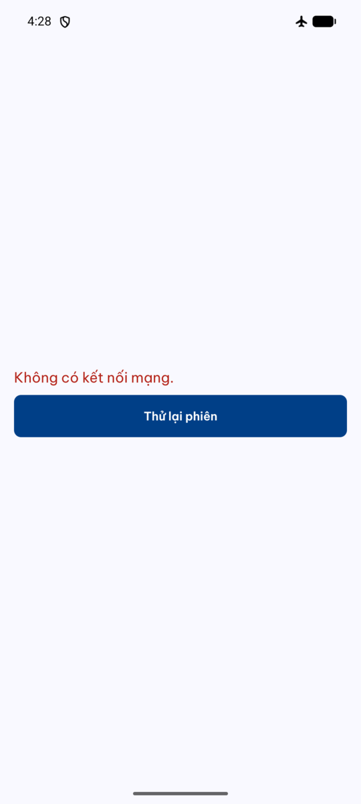 | 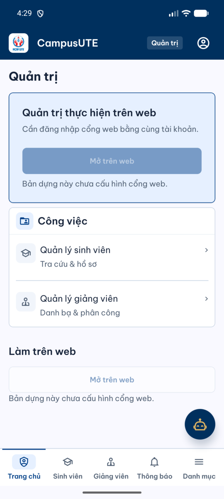 |

Kịch bản trên đã chạy thật trên emulator: bật chế độ máy bay, dừng và mở lại app, ghi nhận màn hình offline;
bật mạng, bấm **Thử lại phiên**, vào lại tổng quan mà không phải đăng nhập lại.

Màn hình đăng xuất khi người dùng chủ động thoát:

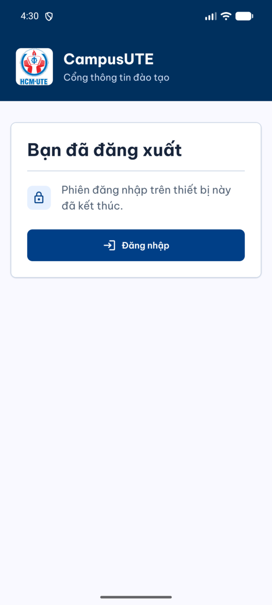

## 7. Chất lượng và bằng chứng

| Hạng mục | Kết quả | Ghi chú |
| --- | --- | --- |
| `npm run typecheck` (mobile) | PASS | Chạy ở commit `2e4b40e4` |
| Jest (`--ci`) | PASS: 86 suite, 956 test, 28 snapshot | Gồm a11y, visual, responsive, vertical-rhythm |
| Node test bắt buộc (`run-node-tests --required`) | PASS: 691 test | Gồm screen atlas, session, transport |
| CI của PR #5 | PASS: 9/9 check ở đúng head `2e4b40e4` | Gồm Java REST API với test PostgreSQL thật, Playwright e2e, Expo mobile |
| Emulator: sinh viên | PASS | Dữ liệu thật: 6 lớp đang học, đăng ký học phần với 19/30 tín chỉ |
| Emulator: giảng viên | PASS | 16 lớp phụ trách, 135 sinh viên, bảng điểm SE401 |
| Emulator: quản trị | PASS | Tổng quan, danh sách sinh viên và giảng viên |
| Emulator: mở app khi offline và phục hồi | PASS | Xem [mục 6](#6-mất-mạng-khi-mở-app) |
| Thiết bị thật | NOT_RUN | Chỉ có emulator x86_64 |

Những cải tiến chính trong đợt hoàn thiện gần nhất:

- **Phiên và offline**: không còn mất phiên khi mở app lúc offline; xem mục 6.
- **Bố cục đáp ứng**: không còn dải trống bên phải; danh sách hai cột trên màn hình rộng; thẻ thống kê tự xếp dọc khi hẹp
  hoặc khi cỡ chữ lớn; hộp thoại và bảng chọn tôn trọng vùng an toàn và cuộn được khi màn hình thấp.
- **Nhịp dọc**: các khối liền kề trên màn staff, lane, assistant, student, academic có khoảng cách tối thiểu;
  test render duyệt cây giao diện và báo lỗi mọi cặp khối dính nhau.
- **Mạng**: tải lên và tải xuống có hạn thời gian tổng (5 phút), huỷ khi đóng màn hình, và bỏ kết quả đến trễ;
  yêu cầu JSON giữ hạn 30 giây.
- **Ngôn ngữ và trợ năng**: tên môn học trong dữ liệu preview hiển thị tiếng Việt ở ngôn ngữ vi; ảnh trang trí được ẩn khỏi TalkBack.
- **Hợp đồng và CI**: các lane merge-gate bắt buộc, kiểm tra migration bất biến, ghim digest cho image bên ngoài.

## 8. Tạo lại ảnh và GIF

Các ảnh và GIF trong `docs/assets/mobile` được quay bằng `adb` và `ffmpeg`, không chỉnh sửa nội dung.

```powershell
# Ảnh chụp, thu về chiều rộng 540 px
adb shell screencap -p /sdcard/shot.png
adb pull /sdcard/shot.png shot.png
magick shot.png -resize 540x -strip dashboard.png

# Quay màn hình 40 giây rồi đổi sang GIF nhỏ (300 px, 8 khung hình/giây, 96 màu)
adb shell screenrecord --time-limit 40 --size 540x1200 --bit-rate 2000000 /sdcard/tour.mp4
adb pull /sdcard/tour.mp4 tour.mp4
ffmpeg -y -i tour.mp4 -vf "fps=8,scale=300:-1:flags=lanczos,split[a][b];[a]palettegen=max_colors=96[p];[b][p]paletteuse=dither=bayer:bayer_scale=4" tour.gif
```

Lưu ý khi đổi tài khoản demo: đăng xuất trong app không kết thúc phiên đăng nhập của nhà cung cấp danh tính, nên lần đăng nhập
sau sẽ tự vào lại tài khoản cũ. Xoá dữ liệu Chrome của emulator (`adb shell pm clear com.android.chrome`) rồi đăng nhập lại.
Đừng dùng `adb reboot` trên emulator: lệnh này tắt hẳn tiến trình emulator thay vì khởi động lại.

## 9. Giới hạn đã biết

- Chỉ kiểm thử trên emulator x86_64; **chưa có thiết bị thật** (cần địa chỉ LAN riêng, profile `local` không cung cấp).
- Cổng web chưa được cấu hình trong bản `local`, nên các nút "Mở trên web" bị tắt.
- Một số lĩnh vực (tuyển sinh, thư viện, việc làm) dùng dữ liệu mô phỏng ở phía sinh viên.
- Tài khoản demo `applicant@campuscore.edu` được seed (V140) kèm vai trò `STUDENT` nhưng không có hồ sơ sinh viên, nên trên app nó hiện vỏ sinh viên và màn Tổng quan báo "không có quyền". Màn tuyển sinh dành riêng cho thí sinh không có vai trò học vụ chỉ được kiểm bằng test, chưa chạy trên emulator.
- Migration V14, V53, V116 là rủi ro đã ghi nhận ở phía cơ sở dữ liệu.
- Ảnh/GIF là bằng chứng trực quan tại một thời điểm; nguồn chuẩn về hành vi là các test và CI.
