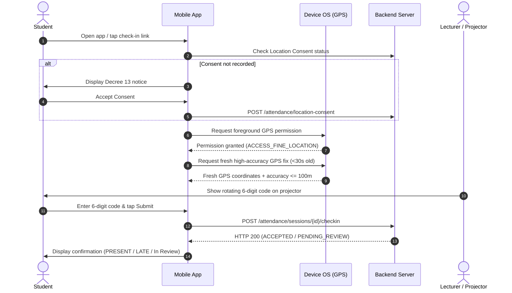

# Attendance Operations Runbook and Real-Device Field-Test Checklist

Status: Active Operations Specification (2026-10-29).
Scope: CampusUTE geofenced attendance system across admin console, lecturer console, student mobile client, and physical device field-test validation.
Authority: Derived from [attendance-geofence-spec.md](attendance-geofence-spec.md), [domain-contracts.md](../../contracts/ecosystem/domain-contracts.md), and [device-runbook.md](device-runbook.md).

---

## 1. Roles and Responsibilities

The geofenced attendance subsystem separates administrative boundary definition, classroom session authority, and student self-checkin into three strictly decoupled roles.

| Role | Primary Interface & Route | Key Operations | Authorizations & Constraints | Verified Code References |
| --- | --- | --- | --- | --- |
| **System Admin** (`ADMIN`, `SUPER_ADMIN`) | Web Admin Console: `/admin/attendance-geofences` | Create, configure, audit, and activate campus geofence perimeters; inspect map markers; deactivate legacy perimeters. | Cannot open class sessions or alter student roll call marks. Must verify physical campus coordinates before activating any perimeter. Deactivates instead of deleting when referenced by sessions. | [`frontend/src/app/admin/attendance-geofences/page.tsx`](file:///D:/CampusUTE_EcoSystem/frontend/src/app/admin/attendance-geofences/page.tsx), [`contracts/ecosystem/domain-contracts.md`](file:///D:/CampusUTE_EcoSystem/contracts/ecosystem/domain-contracts.md#L5-L15) |
| **Lecturer** (`LECTURER`) | Web Lecturer Portal: `/dashboard/lecturer/attendance` (`GeofenceCheckinPanel`, `ProjectorCodeOverlay`) | Open check-in session for assigned section/date; choose active geofence and window duration; display full-screen rotating code; monitor live counters; review flagged check-ins; manually override attendance. | Must be assigned to the class section (`LECT:<section>`). Retains ultimate academic authority: manual roll call entry always overrides student check-in. Rotating code secret never leaves the server. | [`frontend/src/app/dashboard/lecturer/attendance/page.tsx`](file:///D:/CampusUTE_EcoSystem/frontend/src/app/dashboard/lecturer/attendance/page.tsx), [`frontend/src/components/lecturer/GeofenceCheckinPanel.tsx`](file:///D:/CampusUTE_EcoSystem/frontend/src/components/lecturer/GeofenceCheckinPanel.tsx), [`frontend/src/components/lecturer/ProjectorCodeOverlay.tsx`](file:///D:/CampusUTE_EcoSystem/frontend/src/components/lecturer/ProjectorCodeOverlay.tsx) |
| **Student** (`STUDENT`) | Mobile Native App (iOS/Android): Route `attendance.checkin` (`CheckinScreen`) | Accept location privacy consent notice; grant OS foreground location permission; open class session via dashboard or code-free link; submit GPS fix and 6-digit classroom code. | Must be actively enrolled in the section (`ENROLLED` or `CONFIRMED`). Single check-in per installation per session. Web browser check-in is disallowed. | [`mobile/src/screens/attendance-checkin/CheckinScreen.tsx`](file:///D:/CampusUTE_EcoSystem/mobile/src/screens/attendance-checkin/CheckinScreen.tsx), [`mobile/src/attendance-checkin/checkin-machine.ts`](file:///D:/CampusUTE_EcoSystem/mobile/src/attendance-checkin/checkin-machine.ts), [`docs/ecosystem/attendance-geofence-spec.md`](file:///D:/CampusUTE_EcoSystem/docs/ecosystem/attendance-geofence-spec.md#L71-L78) |

---

## 2. Pre-Class Geofence Setup (Admin)

Before any lecturer can open an attendance session, an administrator must create and verify an active geofence perimeter in the admin console.

### 2.1 Creating a Real Campus Geofence

Admins manage perimeters at `/admin/attendance-geofences`.

1. **Access the Console**: Sign in with an account having `ADMIN` or `SUPER_ADMIN` privileges and navigate to the **Attendance Geofences** management page.
2. **Open the Geofence Editor**: Click **New Geofence** (`copy.newAction`).
3. **Form Fields and Constraints**:
   - **Name** (`name`): Descriptive label (e.g., `Building A - Lecture Hall 101`), up to 240 characters (`GEOFENCE_NAME_MAX`).
   - **Campus Code** (`campusCode`): Institutional identifier (e.g., `UTE-MAIN`), up to 60 characters (`GEOFENCE_CAMPUS_CODE_MAX`).
   - **Centre Latitude** (`centerLat`): Decimal degrees with 6 decimal places, range `-90.0` to `+90.0` (`GEOFENCE_LAT_MIN` to `GEOFENCE_LAT_MAX`).
   - **Centre Longitude** (`centerLng`): Decimal degrees with 6 decimal places, range `-180.0` to `+180.0` (`GEOFENCE_LNG_MIN` to `GEOFENCE_LNG_MAX`).
   - **Radius** (`radiusMeters`): Circular boundary radius in metres.
     - **Minimum**: 30 m (`GEOFENCE_RADIUS_MIN_METERS`).
     - **Maximum**: 1000 m (`GEOFENCE_RADIUS_MAX_METERS`).
     - **Default**: 150 m (`V144__attendance_geofence.sql`, `EMPTY_DRAFT`).
   - **Active State** (`isActive`): Checkbox; leave **unchecked** until physical verification is complete.
   - **Operational Note** (`note`): Verification details and surveyor reference, up to 500 characters (`GEOFENCE_NOTE_MAX`).

### 2.2 Obtaining Real Centre Coordinates

Do not guess building coordinates. Real building coordinates must be determined by one of two methods:
- **Method A (Physical On-Site Fix — Recommended)**: Stand at the main physical entrance of the classroom or lecture hall. Using a calibrated GPS device or native smartphone location utility with high accuracy (accuracy $\le 5$ m, clear sky/window line-of-sight), record the latitude and longitude to 6 decimal places.
- **Method B (Official Map Survey)**: Retrieve the cadastral entrance coordinates from the campus facilities map or open the external OpenStreetMap link helper (`buildOsmMarkerUrl`) provided in the admin table. Note that due to strict portal Content Security Policy (`frame-src 'self' blob:`), external map markers open in a new tab rather than an embedded iframe.
- *Illustrative coordinate format only*: Generic HCMC reference `lat 10.850000, lon 106.770000`. Actual building coordinates are NOT VERIFIED in repository source and must be provided by campus facilities staff.

### 2.3 Radius Selection Guidelines

- **Single Classroom / Laboratory (30 m – 50 m)**: Appropriate for compact, well-defined rooms where spillover into adjacent hallways or public roads must be avoided.
- **Large Lecture Hall / Building Wing (50 m – 100 m)**: Balances indoor GPS attenuation with spatial boundary containment.
- **Campus Multi-Building Complex (100 m – 150 m)**: Default setting for open campus quadrangles or multi-story academic buildings.
- *Warning*: Setting a radius greater than 300 m significantly degrades location deterrence; setting a radius below 30 m is blocked by database constraints (`CHECK (radiusMeters BETWEEN 30 AND 1000)` in `V144__attendance_geofence.sql`).

### 2.4 Why the Seeded Placeholder Must NOT Be Used in Production

In database migration [`V144__attendance_geofence.sql`](file:///D:/CampusUTE_EcoSystem/java-services/restful-api/src/main/resources/db/migration/V144__attendance_geofence.sql#L84-L88), the initial seed row is inserted as:
- ID: `ute-main-placeholder`
- Name: `HCM-UTE Vo Van Ngan (UNVERIFIED PLACEHOLDER)`
- Note: `APPROXIMATE ONLY. Admin must verify campus coordinates and radius before enabling.`
- Active: `FALSE`

**Mandatory Rule**: This seed row is strictly an architectural placeholder. Its coordinates (`10.850600, 106.771900`) are rough approximations and do not correspond to any inspected classroom entrance.
The web console [`frontend/src/app/admin/attendance-geofences/page.tsx`](file:///D:/CampusUTE_EcoSystem/frontend/src/app/admin/attendance-geofences/page.tsx#L200-L255) uses `isUnverifiedGeofence()` to detect rows containing `UNVERIFIED` or `APPROXIMATE`. It renders an explicit warning banner (`checkin-seeded-warning`) and requires affirmative confirmation before activation. Enabling this row in production without surveying will cause false `OUTSIDE_AREA` rejections for students in class and false acceptances for students off-campus.

### 2.5 Geofence Verification Checklist

Before activating (`isActive = true`) any perimeter in production, complete this four-point checklist:

| Check # | Step | Verification Action | Acceptance Oracle |
| --- | --- | --- | --- |
| V-01 | Coordinate Sanity | Click the external OpenStreetMap link (`buildOsmMarkerUrl`) in the admin table. | Pin aligns with the actual physical building structure on the campus map. |
| V-02 | Inside Point Test | Tester stands inside the lecture hall and attempts check-in against a test session. | Server returns `ACCEPTED` (or `PENDING_REVIEW` with reason `BORDERLINE` if accuracy is between 50 m and 100 m). |
| V-03 | Outside Point Test (300 m) | Tester moves ~300 m away (e.g., outside the campus perimeter gate) and attempts check-in. | Server rejects request with HTTP 422 `OUTSIDE_AREA` ($d - \text{accuracy} > \text{radius}$). |
| V-04 | Activation Confirmation | Admin toggles **Activate** (`toggleActive`) in the console. | Status pill updates to `Active`. Perimeter is now exposed via `GET /api/v1/attendance/geofences/active`. |

---

## 3. Running Class Attendance (Lecturer)

Lecturers conduct attendance check-in directly from the web portal at `/dashboard/lecturer/attendance`.

### 3.1 Opening a Check-In Session

1. **Select Class and Date**: Choose the active semester, section (`selectedSectionId`), and class date on the campus calendar (`Asia/Ho_Chi_Minh` timezone).
2. **Configure Parameters in `GeofenceCheckinPanel`**:
   - **Geofence**: Select an active verified perimeter from the dropdown list.
   - **Duration Window**: Select 10, 15, 30, 45, or 60 minutes (`CHECKIN_WINDOW_PRESETS_MINUTES`, default 15 minutes).
   - **Late Threshold (`lateAfterMinutes`)**: Enter minutes before check-ins transition from `PRESENT` to `LATE` (default 10 minutes; must not exceed total window duration).
   - **Start Time (Future dates only)**: If scheduling for a future campus date, specify campus-local start time (`HH:mm`).
   - **Require Rotating Code**: Ensure the checkbox **Require rotating code** is enabled (default `true`).
3. **Open Session**: Click **Open Check-in** (`POST /attendance/sessions`). The backend enforces the invariant that only one session may be `OPEN` per (section, date).

### 3.2 Sharing the Code-Free Link & Security Architecture

Upon opening, the panel displays a shareable link (`buildCheckinShareUrl`):
```text
https://www.campusute.io.vn/attendance/checkin/<sessionId>
Deep link: campuscore://attendance/checkin/<sessionId>
```

> [!IMPORTANT]
> **Code-Free Security Contract** ([`frontend/src/lib/attendance-checkin.ts`](file:///D:/CampusUTE_EcoSystem/frontend/src/lib/attendance-checkin.ts#L6-L10)):
> The share link and deep link carry **only** the opaque session ID. By construction, the link **never** contains the rotating code, secret, or coordinates.
> Forwarding this link via chat or social media to a student at home confers zero attendance authority. An absent student opening the link still faces:
> 1. Requirement to enter the short-lived 6-digit code projected only on the physical classroom screen.
> 2. Server-side GPS geofence distance verification ($d - \text{accuracy} \le \text{radius}$).
> 3. Authenticated enrolment check against the class roster.

### 3.3 Classroom Projector Code Overlay

1. In `GeofenceCheckinPanel`, click **Projector Mode** (`Presentation` icon).
2. The full-screen overlay [`ProjectorCodeOverlay.tsx`](file:///D:/CampusUTE_EcoSystem/frontend/src/components/lecturer/ProjectorCodeOverlay.tsx) launches:
   - Displays a 6-digit code in massive high-contrast font (`text-[clamp(4rem,17vw,15rem)]`).
   - Fetches the live code via `GET /attendance/sessions/{id}/code` (`Cache-Control: no-store`).
   - The code is derived on the server from $\text{HMAC-SHA256}(\text{secret}, \lfloor\text{now} / 30\text{s}\rfloor)$. The secret never leaves backend memory.
   - The code rotates every 30 seconds. A visual progress bar and countdown indicator ("Rotates in Xs") show remaining validity.
   - **Tolerance Window**: The backend accepts codes from both the **current step** and the **immediately preceding 30s step** to accommodate slight network transit or clock skew.
   - Click the fullscreen icon or press `F11` for projector display; press `Escape` or the close icon to dismiss.

### 3.4 Live Metric Counters

The panel polls session statistics every 10 seconds while the browser tab is visible:
- **Accepted** (`accepted`): Total check-ins meeting all criteria (valid location, accurate fix, correct rotating code, no fraud flags). Automatically registered as `PRESENT` (or `LATE` if after `lateAfterMinutes`).
- **Pending Review** (`pending`): Check-ins accepted conditionally but flagged by server-side risk heuristics. Requires manual lecturer review before attendance is recorded.
- **Rejected** (`rejected`): Submissions blocked by server security checks (outside geofence, invalid code, expired session, low GPS accuracy).
- **Enrolled** (`enrolled`): Total students on the active class roster.

### 3.5 Flagged Check-In Review Queue & Reason Codes

Check-ins flagged as `PENDING_REVIEW` appear in the **Flagged Reviews** table. The lecturer inspects the flag, distance, accuracy, and timestamp, then clicks **Approve** or **Reject** (with a required justification note).

| Reason Token | Classification | Trigger Condition | Recommended Lecturer Action |
| --- | --- | --- | --- |
| `MOCK_PROVIDER` | Danger | Client reported Android mock location provider active (`mocked = true`). | Inspect student's phone. Reject unless student proves an OS reporting bug on stock firmware. |
| `SHARED_DEVICE` | Warning | The same installation ID (`deviceHash`) checked in two or more different student accounts in the same session. | Indicates one student checking in for absent peers. Cross-check physical presence of both students in the room. |
| `IMPOSSIBLE_SPEED` | Danger | Calculated transit velocity from student's prior check-in exceeds 150 km/h. | Probable GPS spoofing or account sharing across distant locations. Reject unless prior record was logged elsewhere hours earlier. |
| `IDENTICAL_COORDINATES` | Danger | Exact coordinates identical to 5 decimal places shared by more than 3 students in the session. | Unnatural GPS behaviour; indicates shared spoofing coordinate broadcast. Investigate and reject if artificial. |
| `ZERO_ACCURACY` | Danger | GPS reported horizontal accuracy of exactly 0.0 m. | Synthetic or emulator fix. Real satellite GPS always carries positive dispersion ($\ge 2$ m). |
| `BORDERLINE` | Warning | Distance $\le \text{radius}$ but accuracy between 50 m and 100 m; or radius boundary overlaps accuracy error circle. | Approve if student is physically recognized in the room. |
| `LOW_ACCURACY` | Warning | GPS accuracy dispersion more than 100 m (indoor multipath interference). | Advise student to step near a window and retry. |

### 3.6 Manual Attendance Record Precedence

Under [`docs/ecosystem/attendance-geofence-spec.md`](file:///D:/CampusUTE_EcoSystem/docs/ecosystem/attendance-geofence-spec.md#L53) and [`contracts/ecosystem/domain-contracts.md`](file:///D:/CampusUTE_EcoSystem/contracts/ecosystem/domain-contracts.md#L31-L34):
- **Manual Always Wins**: A lecturer's manual entry on the attendance sheet takes absolute precedence over any student check-in.
- If a lecturer marks a student `ABSENT` or `PRESENT` manually, an automated check-in cannot overwrite it. The check-in returns status `MANUAL_RECORD_PRESERVED`.
- When approving a flagged check-in from `PENDING_REVIEW`, the server evaluates `PRESENT` vs `LATE` using the **original client capture timestamp**, not the review time.
- If a lecturer rejects a flagged check-in, the existing manual roll call record (or default `ABSENT`) remains unchanged.

### 3.7 Closing the Session

- **Automatic Expiration**: The session terminates automatically when `closesAt` is reached (countdown reaches zero).
- **Manual Early Close**: In `GeofenceCheckinPanel`, click **Close Session**. Confirm in the dialog. The session transitions to `CLOSED` (`closedAt = NOW()`).
- Any subsequent check-in attempt immediately receives HTTP 410 `SESSION_CLOSED`.

---

## 4. Student Check-In Workflow

Students use the native CampusUTE mobile app. Web browser check-in is intentionally unsupported due to trivial coordinate spoofing.

### 4.1 Standard Check-In Sequence



1. **Launch App**: Open the CampusUTE native mobile app on a physical Android or iOS device.
2. **Review Consent (First Use)**: On the initial check-in, review the Decree 13/2023 Location Consent disclosure (`AttendanceLocationConsent`). The notice details: one-time coordinate capture at check-in, 30-day retention, attendance verification purpose only. Tap **Accept**.
3. **Locate Open Session**: Tap **Attendance** on the dashboard or open the lecturer's session link / deep link (`campuscore://attendance/checkin/<sessionId>`).
4. **Grant Foreground Location**: When prompted, grant OS foreground permission ("While using the app" / `ACCESS_FINE_LOCATION`). Ensure system Location Services are enabled.
5. **Acquire GPS Position**: App automatically acquires a fresh, high-accuracy fix (`timeoutMs: 15000`, maximum age 30 s, accuracy $\le 100$ m).
6. **Input Projector Code**: Read the 6-digit rotating code currently displayed on the classroom projector screen and enter it into the numeric keypad.
7. **Submit Check-In**: Tap **Check In**. The app posts `{code, latitude, longitude, accuracyMeters, capturedAt, mockProvider, installationId}`.
8. **View Result**:
   - `ACCEPTED`: Marked `PRESENT` (or `LATE` if past threshold).
   - `PENDING_REVIEW`: Queued for lecturer review with reason badge.

### 4.2 Handling Exception Paths

- **Link opened while signed out**: Deep link handler preserves target route parameters; redirects to OIDC login. Once authenticated, routes back to `attendance.checkin` for that session.
- **Link opened by a student not enrolled in the section**: Backend checks section enrollment; returns HTTP 403 `NOT_ENROLLED`. App displays `notEnrolled` ("You are not enrolled in this section") with a return button.
- **Session window closed**: If $t > \text{closesAt}$, backend returns HTTP 410 `SESSION_CLOSED`. App renders `sessionClosed` state with an explanation that the check-in window has elapsed.
- **Location permission denied or blocked**:
  - `denied-can-ask`: App displays `needsPermission` with an action button to re-request permission.
  - `denied-blocked`: App displays `permissionBlocked` with an action button directing the user to OS App Settings (`Linking.openSettings()`).
- **GPS accuracy too low**: If accuracy $> 100$ m, client machine throws `LOW_ACCURACY`. App displays tips: step away from dense concrete structures, approach an exterior window, enable Wi-Fi for Google/Apple Location Accuracy assist, and tap **Retry**.

---

## 5. Real-Device Field-Test Checklist

This section governs the formal physical device field-test required before accepting release gate `devices` for geofenced attendance.

### 5.1 Preconditions & Environment

1. **Physical Devices**: At least one physical Android smartphone (API 30+, Android 11–14+) and one physical iOS device (iOS 17–18+) running the signed production or internal preview build (`io.campuscore.mobile`).
2. **Connectivity**: Real mobile data (LTE/5G) or authenticated campus Wi-Fi connection.
3. **Accounts**: One active lecturer test account and at least two distinct enrolled student test accounts.
4. **Physical Location**: Campus classroom designated for testing.

### 5.2 Strict Prohibition on Location Mocking

> [!CAUTION]
> **NO MOCK LOCATION / DEVELOPER TOOLS ON PHYSICAL FIELD TESTS**:
> Field-test verification on physical devices must validate **authentic GPS hardware and OS location manager pipelines**.
> - It is strictly forbidden to use Android Developer Options "Select mock location app", Fake GPS apps, mock location daemons, or `adb emu geo fix` commands on physical test phones.
> - The student test device must have mock location disabled. Any check-in arriving with `mockProvider = true` fails the clean acceptance oracle.
> - **Emulator Test Distinction**: Any test executed on Android Studio Emulator or iOS Simulator must be explicitly tagged as `EMULATOR_ONLY` in records and **never counts** toward the physical device field-test gate.

### 5.3 Test Execution Matrix

Execute each scenario in order and document results in the evidence file.

| Case ID | Scenario | Execution Steps | Expected Oracle | Evidence Recording |
| --- | --- | --- | --- | --- |
| **GEO-01** | Real Perimeter Activation | Admin navigates to `/admin/attendance-geofences`, inputs surveyed classroom coordinates and radius (e.g. 50 m), verifies map pin, and toggles Active. | Geofence persists with `isActive = true`; appears in `GET /api/v1/attendance/geofences/active`. | Record geofence ID and admin table screenshot. |
| **GEO-02** | Session Open & Projector | Lecturer opens 15-min session for section with `requireCode = true`; launches Projector Mode overlay. | Session status `OPEN`; 6-digit code displays on projector; rotates every 30 s. | Record session ID, lecturer screen, and projector code. |
| **GEO-03** | Inside Geofence (Happy Path) | Student 1 stands inside classroom on physical phone, grants GPS permission, inputs active projector code, submits. | HTTP 200 `ACCEPTED`, status `PRESENT` (or `LATE` if past threshold). Live counter increments. | App success screen + Lecturer live counter update. |
| **GEO-04** | Outside Geofence Rejection | Student 1 walks more than 300 m away from classroom (e.g., campus main entrance or street), inputs valid active code, submits. | HTTP 422 `OUTSIDE_AREA`. Check-in rejected. App displays "Outside check-in area". Roll call not marked. | App rejection screen + backend attempt log entry (`OUTSIDE_AREA`). |
| **GEO-05** | Wrong Code Rejection | Student 1 stands inside classroom, enters deliberate wrong code `000000`, submits. | HTTP 422 `BAD_CODE`. Check-in rejected. App displays "Invalid code". | App error screenshot. |
| **GEO-06** | Expired Code Rejection | Student 1 stands inside classroom, captures a code, waits more than 65 s (2 full rotation steps), submits the stale code. | HTTP 422 `BAD_CODE` (code outside current and previous 30s step). Check-in rejected. | App error screenshot + timestamp log. |
| **GEO-07** | Duplicate Idempotency | Student 1 (already accepted in GEO-03) submits check-in again within the same open session. | HTTP 409 `ALREADY_CHECKED_IN`. App displays "Already checked in". No duplicate attendance row. | App confirmation screen. |
| **GEO-08** | Code-Free Share Link Isolation | Student 2 receives forwarded share link `https://.../attendance/checkin/<sessionId>` via messaging app. | Opening link launches app/browser but prompts for the 6-digit classroom code. Submitting without code is blocked. | App code input screen proof. |
| **GEO-09** | Shared Device Flagging | Student 2 signs in on Student 1's physical device and checks in to the same session. | HTTP 200 `PENDING_REVIEW` with reason `SHARED_DEVICE`. Check-in held in lecturer review queue. | Lecturer flagged review table screenshot. |

### 5.4 Evidence Recording Conventions

Field-test results must be logged following the conventions of [`docs/ecosystem/device-evidence-template.md`](file:///D:/CampusUTE_EcoSystem/docs/ecosystem/device-evidence-template.md):
1. **Target Artifact**: Copy template to `artifacts/verification/devices/android-<buildId>.md` and `artifacts/verification/devices/ios-<buildId>.md`.
2. **Mandatory Metadata Header**:
   - `OS + version`: e.g., `Android 14 (API 34)` / `iOS 18.1`
   - `Device model`: e.g., `Samsung Galaxy S23` / `iPhone 15 Pro`
   - `App build`: EAS internal build ID + internal build number
   - `Runtime version`: Output from `eas build:inspect`
   - `Signing fingerprint`: SHA-256 certificate fingerprint (Android) or TeamID (iOS)
   - `Git SHA`: Commit hash the binary was compiled from
   - `Evidence collector`: Tester name + timestamp in UTC
   - `Package ID`: `io.campuscore.mobile`
3. **Verdict Criteria**: Mark each scenario `PASS`, `FAIL`, or `BLOCKED_CAPABILITY`. An overall test pass requires all rows to be `PASS`. Any emulator-derived result must be tagged `EMULATOR_ONLY` and does not clear the physical device gate.

---

## 6. Operations Troubleshooting Guide

| Symptom | Probable Cause | Diagnostic Check | Remediation Action |
| --- | --- | --- | --- |
| Students in room always receive `OUTSIDE_AREA` | 1. Geofence centre coordinates mistyped.<br>2. Radius too small (<30 m or not covering the full room).<br>3. Classroom has severe GPS multipath offset. | 1. Open admin console, click OSM map link, verify pin location.<br>2. Check student reported distance in lecturer review table vs radius. | 1. Re-survey entrance coordinates.<br>2. Expand radius in admin console (e.g. from 50 m to 100 m).<br>3. Update geofence record. |
| App continuously reports `LOW_ACCURACY` | 1. Indoor concrete shielding blocks GPS satellites.<br>2. Phone location mode set to "Device only / GPS only" without Wi-Fi assist. | Inspect reported accuracy in device settings; check if accuracy more than 100 m. | 1. Enable "Google Location Accuracy" (Android) or "Precise Location" (iOS).<br>2. Ensure Wi-Fi is enabled.<br>3. Have students step near a window for initial satellite lock. |
| Code repeatedly rejected (`BAD_CODE`) | 1. Severe system clock skew on mobile device (more than 15 s offset).<br>2. Student entering code after rotation expired. | Check phone system time against world time (`time.google.com` or network NTP). | 1. In phone OS settings, toggle "Set time automatically" ON.<br>2. Ensure students enter the freshly displayed code before the progress bar empties. |
| Legitimate student flagged with `MOCK_PROVIDER` | Third-party developer tools, debugging proxies, or mock provider left enabled in Android Developer Options. | Go to Android Settings $\to$ Developer options $\to$ "Select mock location app". | 1. Set mock location app to "None".<br>2. Disable Developer Options if not debugging.<br>3. Lecturer can manually approve the flagged check-in with a review note. |
| Legitimate student flagged with `SHARED_DEVICE` | Two students checked in from the same smartphone (e.g. one student borrowed peer's phone due to dead battery). | Check `deviceHash` in review table; inspect student identities. | 1. Each student must use their own personal installation.<br>2. If verified genuine emergency, lecturer clicks **Approve** and notes the exception. |
| Student receives `SESSION_CLOSED` (410) | Session window elapsed (e.g. 15 minutes expired) or lecturer manually closed session. | Check session status and countdown in lecturer panel. | If class roll call is still ongoing, lecturer opens a new check-in window or marks the student directly on the attendance sheet. |
| Student receives `NOT_ENROLLED` (403) | Student is attending wrong section or enrollment is in dropped/unconfirmed state. | Verify student ID in class section roster table (`academic."Enrollment"`). | Student must register in the correct section. Lecturer may manually record attendance as visitor/transfer if authorized. |
| Student stuck on `needsConsent` | Student declined or dismissed the location privacy disclosure. | Check app check-in screen; verify whether consent dialog appears. | Tap **Accept** on the Decree 13 location privacy notice. Check-in cannot proceed without recorded consent. |
| Lecturer panel shows `pollStale` | Network disconnection or lecturer tab backgrounded. | Check browser connection and tab visibility indicator. | Return tab to foreground or click retry; panel resumes 10s polling automatically. |

---

## 7. Data Handling and Privacy Pointer

For complete personal data handling specifications, legal basis under Vietnamese Decree 13/2023, consent versioning protocols, and the automated 30-day coordinate truncation lifecycle, see [attendance-privacy-and-data-safety.md](attendance-privacy-and-data-safety.md).
