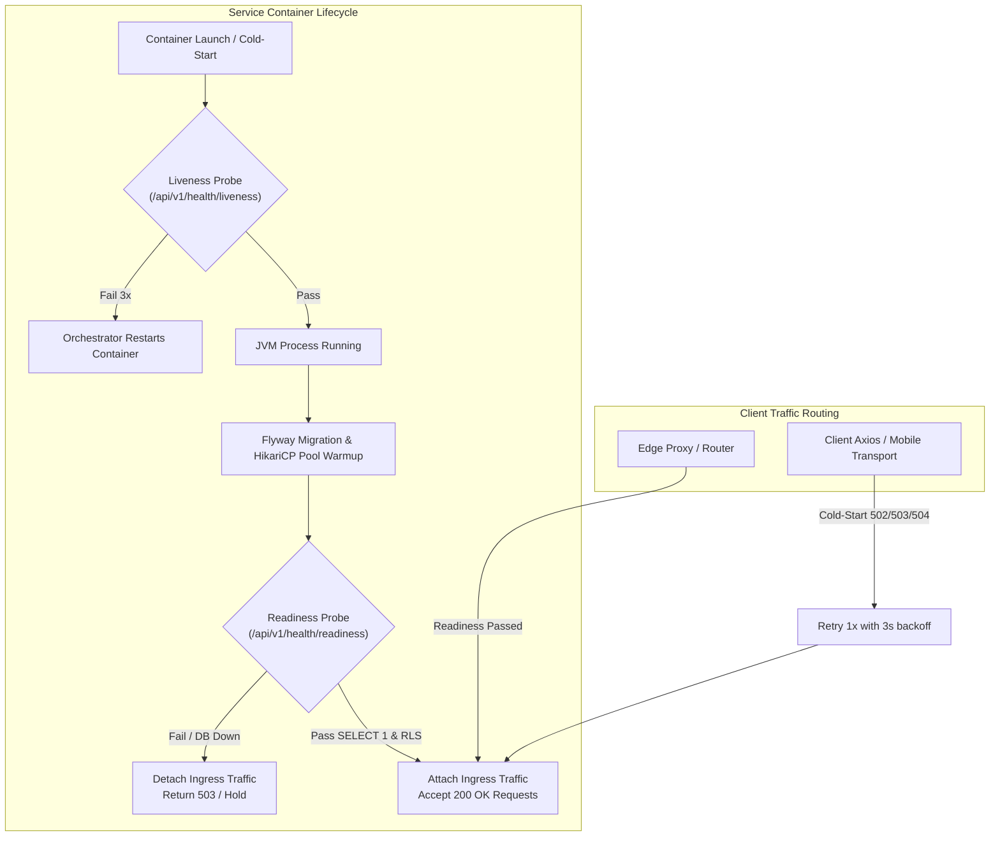

# Observability contract — correlation id, metrics, log redaction, SLOs & alerts

Pha: P03 step 3 · Owner: controller · Review: Kongming + tester contract
Audit reference: AUD-26 (Service SLOs, Operational Alert Definitions, and Probe Semantics)
Liên quan: `contracts/ecosystem/domain-contracts.md`, gate `contracts` trong
`scripts/verify-ecosystem.gates.json`, `scripts/contract-verify.mjs`, `ops/monitoring/`.

---

## 1. Correlation id (`X-Request-Id`) & Cross-Tier Join Procedure

### 1.1 Contract & Surface Matrix

| Điểm | Hành vi | Trạng thái |
| --- | --- | --- |
| Server | `RequestIdFilter` (HIGHEST_PRECEDENCE) nhận header `X-Request-Id` nếu khớp `[A-Za-z0-9._:-]{1,128}`, ngược lại tự sinh UUID; id đặt vào request attribute (`RequestIdFilter.ATTRIBUTE`) + echo trên mọi HTTP response | EXISTING (`RequestIdFilter.java:19`) |
| Mobile | `createApiClient.requestWithMeta` sinh `mobile-<ts>-<rand>` mỗi request; refresh gắn `<id>-refresh`; `ApiClientError` mang `requestId` để support join | EXISTING (P03 thêm metric hook) |
| Web | axios request interceptor trong `frontend/src/lib/api.ts` gắn `newRequestId()` nếu caller chưa đặt; response id đi vào `ApiMetric.requestId` | EXISTING (`frontend/src/lib/observability.ts:7`) |
| Quy tắc | Client KHÔNG tái sử dụng id giữa các request; id do caller cung cấp bị server validate — giá trị ngoài charset bị thay bằng UUID server (probe `invalid` trong contract-verify chứng minh) | contract |

Support/audit join: `X-Request-Id` trên response error + log server + metric
client dùng chung một giá trị — không thêm trace header thứ hai ở pha này.

### 1.2 Multi-Tier Log Join Procedure

Khi người dùng gặp sự cố hoặc alert kích hoạt, quy trình đối soát log xuyên suốt các tầng:

1. **Client Capture**:
   - Khi API trả về lỗi (4xx/5xx), payload chuẩn `ErrorResponse` luôn chứa trường `requestId`:
     ```json
     {
       "timestamp": "2026-10-29T12:00:00Z",
       "status": 500,
       "code": "INTERNAL_ERROR",
       "message": "An unexpected internal error occurred",
       "path": "/api/v1/academic/me/enrollments",
       "requestId": "req-m490f2-1a2b3c4d5e"
     }
     ```
   - Client-side error boundary / logger ghi lại `requestId` từ response body hoặc header `X-Request-Id`.
2. **Edge / BFF Proxy Join**:
   - Web frontend route handlers (ví dụ `/health` hoặc Next.js server actions) forward `X-Request-Id` hoặc log với prefix correlation.
3. **Java API Log Search**:
   - `GlobalExceptionHandler` log unhandled exceptions với định dạng:
     `"Unhandled internal server exception at /api/v1/... (requestId: <id>)"`.
   - Tìm kiếm log qua lệnh container hoặc log aggregator:
     ```bash
     # Local / Docker Compose
     docker compose logs api | grep "<requestId>"

     # Aggregated Log System (Loki / CloudWatch / Datadog)
     {service="restful-api"} |= "<requestId>"
     ```
4. **Database Query / Transaction Correlation**:
   - Trace từ `requestId` tại API xuống log database connection hoặc transaction lock ordering (như audit table `assistant.chat_turn_ledger` với `client_request_id`).

---

## 2. Metric hooks & Metric Inventory

### 2.1 Client-side Metric Hooks

Mỗi app có module pure `observability` (web: `frontend/src/lib/observability.ts`,
native: `mobile/src/api/observability.ts`) cùng contract:

```typescript
recordApiMetric({ method, path, status, durationMs, requestId, at })
apiMetricsSnapshot()            // bounded ring, 100 entry cuối
subscribeApiMetrics(listener)   // hook cho debug/dev overlays, tương lai OTel
redactForLog(value)             // xem §3
```

Ring buffer chỉ là **metric hook nội bộ** — không phải telemetry sink; không
persist, không gửi đi. `durationMs` đo từ request start tới response cuối
(sau retry chain cuối cùng ở web, sau fetch cuối ở native).

`path` trong metric là **path-template**: segment trông như resource id
(UUID, số, hex ≥16 ký tự) được `pathTemplate()` gom về `{id}` trước khi vào
ring — tránh cardinality nổ và tránh entity id rơi vào metric artifact.

Bất đối xứng có chủ đích giữa hai transport (ghi nhận, không ép đồng nhất):
request id của native là `mobile-*` do client tự sinh và gửi lên server như
mọi client id khác (server vẫn validate charset); `durationMs` web gồm cả
retry chain axios, native chỉ gồm fetch cuối sau refresh.

### 2.2 Metric Inventory (Verified In-Code vs "TO INSTRUMENT")

Nhằm ngăn chặn phantom metrics, bảng sau phân định rõ những endpoint/metric đã thực sự tồn tại trong code và những metric cần bổ sung instrument khi kích hoạt Prometheus backend:

| Tên Metric / Probe / Header | Vị trí trong Codebase | Trạng thái Code | Mô tả vận hành |
| :--- | :--- | :--- | :--- |
| `GET /api/v1/health/liveness` | `HealthController.java:43` | **VERIFIED_IN_CODE** | Probe kiểm tra tiến trình JVM sống. Không chạm database. |
| `GET /api/v1/health/readiness` | `HealthController.java:53` | **VERIFIED_IN_CODE** | Probe sẵn sàng phục vụ. Bắt buộc header `X-Health-Key`. Chạy `SELECT 1` và kiểm tra RLS. |
| `GET /actuator/health` | `application.yml:156` | **VERIFIED_IN_CODE** | Spring Boot Actuator health endpoint (public qua `SecurityConfig.java:181`). |
| `GET /actuator/health/liveness` | `application.yml:159` | **VERIFIED_IN_CODE** | Built-in Spring Boot liveness probe (`probes.enabled=true`). |
| `GET /actuator/health/readiness` | `application.yml:159` | **VERIFIED_IN_CODE** | Built-in Spring Boot readiness probe (`probes.enabled=true`). |
| `GET /health` (Web) | `frontend/src/app/health/route.ts:6` | **VERIFIED_IN_CODE** | Route kiểm tra web edge/SSR; proxy tới `/api/v1/health/liveness`. |
| Header `X-Request-Id` | `RequestIdFilter.java:19` | **VERIFIED_IN_CODE** | Header truy vết phân tán xuyên suốt Web, Native và REST API. |
| Headers `X-RateLimit-*`, `Retry-After` | `RateLimitFilter.java:121` | **VERIFIED_IN_CODE** | Header trả về giới hạn quota và thời gian chờ khi gặp 429 `RATE_LIMIT_EXCEEDED`. |
| `http_server_requests_seconds_*` | `pom.xml` (`spring-boot-starter-actuator`) | **TO INSTRUMENT** | Timer đo độ trễ và số lượng request HTTP. Cần thêm `micrometer-registry-prometheus` vào `pom.xml`. |
| `hikaricp_connections_*` | `application.yml:284` (`spring.datasource.hikari`) | **TO INSTRUMENT** | Gauge/counter đo trạng thái pool kết nối PostgreSQL (active, idle, pending, timeout). Cần Micrometer Prometheus. |
| `campuscore_assistant_requests_total` | `ThesisAssistantController.java` | **TO INSTRUMENT** | Metric đếm số lượng chat assistant kèm nhãn `{degraded="true|false", reason_code="..."}`. |
| `campuscore_assistant_quota_consumed` | `ThesisAssistantTurnRepository.java` | **TO INSTRUMENT** | Gauge theo dõi hạn mức sử dụng hàng ngày (user quota: 20, global quota: 200). |
| `campuscore_assistant_turn_stale_recovered` | `ThesisAssistantService.java` | **TO INSTRUMENT** | Counter đếm số lượt khôi phục lease quá hạn (`RESERVED`/`DISPATCHED` -> `FAILED_AMBIGUOUS`). |

---

## 3. Log redaction & Sensitive Data Boundaries

Nguyên tắc bất biến: Thông tin xác thực (Bearer token, refresh token, password, cookie,
`Authorization`/`Set-Cookie` header value, token/password/secret trong URL query) và dữ liệu
định danh cá nhân nhạy cảm (PII: số CCCD, mật khẩu băm, chữ ký cá nhân) **không bao giờ**
được phép xuất hiện trong application log, error `message`, hay client console/debug artifact.

### 3.1 Quy tắc Redaction bắt buộc

- `redactForLog()` trong cả hai module `observability` (web và mobile) thực hiện:
  - Strip `Bearer [A-Za-z0-9._~+/=-]+` thành `Bearer <redacted>`.
  - Strip query params: `([?&](?:access_token|refresh_token|token|password|secret)=)[^&\s]+` thành `$1<redacted>`.
  - Strip auth/cookie trong JSON/string: `"(cookie|authorization|set-cookie)"\s*:\s*"[^"]*"` thành `"$1":"<redacted>"`.
- Spring Boot REST API:
  - Cấu hình `server.error.include-message: never` và `server.error.include-stacktrace: never` trong `application.yml` ngăn rò rỉ cấu trúc bảng, tên cột hoặc stack trace qua error response.
  - `GlobalExceptionHandler` chuẩn hóa lỗi trả về `ErrorResponse` chỉ chứa thông điệp khái quát (ví dụ `"Operation conflicted with existing database state"` cho `DataIntegrityViolationException`), không in câu lệnh SQL.

### 3.2 Sentinel Test Verification

Gate `contracts` case `contract-probes` chạy sentinel test tự động:
- Gửi Bearer token dạng `SENTINEL-BEARER-*` và mật khẩu dạng `SENTINEL-PASS-*` tới API thật.
- Quét toàn bộ log sinh ra (`docker compose logs api`).
- Bất kỳ sự xuất hiện literal nào của chuỗi sentinel trong log lập tức bị đánh trượt (**FAIL** gate).

---

## 4. Cache / private-response contract

| Kiểm | Cơ chế | Case gate |
| --- | --- | --- |
| Private response `no-store` | Spring Security default headers phát `Cache-Control: no-cache, no-store, max-age=0, must-revalidate` + `Pragma: no-cache` + `Expires: 0` trên mọi response. Assert bắt buộc trên **private-class** (protected → 401 phải `no-store` + status đúng 401); public feed/api-docs **ghi nhận** vì P06 được phép thêm public caching | `contract-probes` |
| Cross-account cache | Web: `query-cache-identity.test.js` — SSR không share client, AuthContext `clear()` mọi identity transition, session race không hồi sinh user cũ, **real `QueryClient.clear()` evict hết entry** (không chỉ stub). Native: `sessionEpoch` guard — refresh rotation của session cũ không đè session mới (test mô phỏng refresh pending + sign-in mới). Mobile có **in-memory query cache** (`mobile/src/hooks/query-cache.ts`): key gồm account id + query key + scope (locale/role/grants/filter/page), không persist; `clear()` chạy trên mọi identity transition (sign-out, session hết hạn, đổi account) nên không rò rỉ dữ liệu giữa tài khoản. Tài nguyên lane nhạy cảm (`lane.*`, `dean.*`, `staff.*`, `admin.*`) được đánh dấu `UNCACHEABLE` — cố ý không cache; `sessionEpoch` vẫn là lớp chống refresh-race đè session | `cross-account-cache` (node --test) |
| Cache phía client của API | axios instance gửi `Cache-Control: no-store` request header | EXISTING |

Giới hạn còn lại (ghi trung thực): probe `no-store` mới chứng minh trên
private-**class** response (401 unauthenticated). Authenticated 200 responses
của private endpoints chưa được probe — cần session thật, thuộc bước khi P04
identity/session hoàn chỉnh; được kỳ vọng pass vì header phát ở filter chain
chung, nhưng chưa là bằng chứng.

---

## 5. Probes & Cold-Start Semantics: Liveness vs Readiness vs Health

> [!IMPORTANT]
> **Health không được nhầm lẫn với Readiness!**
> Việc cấu hình sai probe giữa Liveness và Readiness dẫn đến hiện tượng reboot-loop khi dịch vụ khởi động lạnh (cold-start) trên nền tảng đám mây (Render, Fly.io, Kubernetes).



### 5.1 Phân định trách nhiệm Probe

1. **Liveness Probe (`/api/v1/health/liveness` hoặc `/actuator/health/liveness`)**:
   - **Mục đích**: Xác định xem tiến trình Java/JVM có còn phản hồi hay đã rơi vào trạng thái deadlock/OOM crash.
   - **Quy tắc**: Tuyệt đối **không kiểm tra** database hay external network dependencies.
   - **Hành động khi Fail**: Container Orchestrator (Docker/Kubernetes/Render) tiến hành khởi động lại (restart) container.
   - **Tham số khuyến nghị**: `initialDelaySeconds: 45`, `periodSeconds: 15`, `timeoutSeconds: 5`, `failureThreshold: 3`.
2. **Readiness Probe (`/api/v1/health/readiness` hoặc `/actuator/health/readiness`)**:
   - **Mục đích**: Xác định xem instance đã sẵn sàng tiếp nhận request của người dùng hay chưa (kết nối PostgreSQL thành công qua `SELECT 1`, Flyway schema ổn định, Assistant RLS đã kiểm tra).
   - **Bảo mật**: Yêu cầu header `X-Health-Key` khớp giá trị cấu hình `health.readiness-key` (`HEALTH_READINESS_KEY`).
   - **Hành động khi Fail**: Tạm thời ngắt lưu lượng truy cập từ load balancer / ingress; **tuyệt đối không restart** container ngay, cho phép database tự phục hồi hoặc hoàn tất migration.
   - **Tham số khuyến nghị**: `initialDelaySeconds: 20`, `periodSeconds: 10`, `timeoutSeconds: 3`, `failureThreshold: 3`.
3. **Aggregated Health (`/actuator/health`)**:
   - Tổng hợp trạng thái các component. Không dùng làm liveness probe vì nếu một module phụ suy giảm trạng thái, liveness sẽ restart nhầm cả ứng dụng.
4. **Web Frontend Health (`/health`)**:
   - Được định nghĩa tại `frontend/src/app/health/route.ts`. Proxy trực tiếp tới `/api/v1/health/liveness` với `X-Request-Id` tương ứng.

### 5.2 Cơ chế giảm thiểu Cold-Start (Render / Serverless)

- Trên Render free-tier, container bị sleep sau thời gian nhàn rỗi. Thời gian đánh thức JVM và khởi tạo Hibernate/HikariCP mất từ 15 đến 40 giây.
- **Client-side Absorption**: Interceptor axios của frontend tự động retry một lần (với 3s backoff) đối với các request GET idempotent khi nhận mã 502/503/504 từ gateway trong quá trình cold start.
- **Warm Ping Mitigation**: Database migration `supabase/migrations/20260920210000_render_keepalive_warm_ping.sql` hỗ trợ gửi ping định kỳ 10 phút qua `pg_cron` + `pg_net` nhằm giữ container không bị sleep (xem chi tiết tại [PRODUCTION_RUNBOOK.md](file:///D:/CampusUTE_EcoSystem/docs/PRODUCTION_RUNBOOK.md#render-cold-start-mitigation)).

---

## 6. Service Level Objectives (SLOs) theo Critical User Journeys

Mỗi luồng nghiệp vụ trọng yếu (Critical User Journey) được áp đặt chỉ tiêu SLI/SLO chặt chẽ:

| Critical Journey | Endpoints Sở hữu | SLI Độ trễ (P95) | SLO Độ trễ | SLI Tỷ lệ Lỗi (5xx) | SLO Tỷ lệ Lỗi | Availability SLO (30 ngày) |
| :--- | :--- | :--- | :--- | :--- | :--- | :--- |
| **Sign-in (Đăng nhập)** | `POST /api/v1/auth/login`<br>`POST /oauth2/token` | P95 latency của HTTP request | **< 800 ms** (bao gồm chi phí Argon2/BCrypt hashing) | Số request 5xx / Tổng số request đăng nhập | **< 0.1%** (Loại trừ lỗi nhập sai pass 401) | **99.9%** |
| **Course Registration (Đăng ký học phần)** | `POST /api/v1/academic/me/enrollments`<br>`DELETE /api/v1/academic/me/enrollments/{sectionId}` | P95 latency của HTTP mutation | **< 500 ms** (dưới tải cao mùa đăng ký) | Số request 5xx / Tổng số lượt ghi danh | **< 0.2%** (Loại trừ business conflict 409 SECTION_FULL, 400 CREDIT_CAP) | **99.8%** |
| **Attendance Check-in (Điểm danh)** | `POST /api/v1/attendance/sessions/{id}/checkin` | P95 latency của check-in | **< 600 ms** (bao gồm geofence check & idempotency lock) | Số request 5xx / Tổng lượt điểm danh | **< 0.1%** (Loại trừ 422 OUTSIDE_AREA, 409 ALREADY_CHECKED_IN) | **99.9%** |
| **Grades Read (Xem điểm/Bảng điểm)** | `GET /api/v1/enrollments/my/grades`<br>`GET /api/v1/enrollments/my/transcript`<br>`GET /api/v1/grades/.*` | P95 latency của read query | **< 300 ms** | Số query 5xx / Tổng số lượt đọc điểm | **< 0.05%** | **99.95%** |

---

## 7. Resource Saturation & Operational Boundaries

### 7.1 Database Connection Pool Saturation (HikariCP)
- Cấu hình chuẩn (`application.yml`):
  - Primary API Pool: `maximum-pool-size: 8` (`DB_POOL_MAX: 8`), `connection-timeout: 15000ms`, `minimum-idle: 0`.
  - Assistant Pool: `maximum-pool-size: 4` (`ASSISTANT_DB_POOL_MAX: 4`), `connection-timeout: 15000ms`.
- **Ngưỡng Cảnh báo (Warning)**: Tỷ lệ kết nối active `> 80%` kéo dài liên tục trên 3 phút.
- **Ngưỡng Nguy cấp (Critical)**: Tỷ lệ kết nối active `>= 95%` hoặc số lượng request xếp hàng chờ (`pending`) `> 2` trong 1 phút, hoặc xuất hiện bất kỳ sự kiện connection timeout nào (`hikaricp_connections_timeout_total > 0`).

### 7.2 Rate-Limit 429 Rates (`RateLimitFilter`)
- Cấu hình danh mục trượt (`RateLimitFilter.java`):
  - `AUTH_LOGIN`: 15 requests / 60 giây (khóa theo IP).
  - `TWO_FACTOR_VERIFY`: 10 requests / 15 phút (khóa theo IP).
  - `FORGOT_PASSWORD`: 5 requests / 60 phút.
  - `ENROLLMENT_MUTATION`: 15 requests / 60 giây.
  - `ASSISTANT_CHAT`: 20 requests / 60 giây.
  - `DEFAULT_POST`: 40 requests / 60 giây.
- **Ngưỡng Cảnh báo**: Tổng tỷ lệ phản hồi 429 vượt quá 5% tổng lưu lượng toàn hệ thống trong 5 phút.
- **Ngưỡng Tấn công (Security Critical)**: Tỷ lệ 429 trên `/api/v1/auth/login` vượt quá 50 requests/phút trong 2 phút (dấu hiệu tấn công brute-force / credential stuffing).

### 7.3 Assistant Provider Errors, Quota & Turn Recovery
- Hạn mức (`AssistantProperties.java`):
  - `user-daily-quota`: 20 turns/ngày.
  - `global-daily-quota`: 200 turns/ngày.
- **Outage & Degraded Contract**: Khi DeepSeek gặp timeout (>15s), provider error hoặc cạn hạn mức, hệ thống tự động suy giảm về lexical RAG với cờ `degraded: true` và `reasonCode` tương ứng (`PROVIDER_TIMEOUT`, `GLOBAL_QUOTA_EXCEEDED`, `CIRCUIT_OPEN`).
- **Ngưỡng Cảnh báo**:
  - Tỷ lệ câu trả lời degraded `> 20%` trong 10 phút.
  - Hạn mức toàn hệ thống chạm ngưỡng `>= 90%` (180/200 turns).
  - Đợt quét dọn lease quá hạn (30s recovery sweep) thu hồi `> 5` turns bị kẹt trong trạng thái `FAILED_AMBIGUOUS` trong 10 phút.

---

## 8. Alert Rules Manifests & Operational Severity Matrix

Tất cả các định nghĩa cảnh báo được lưu trữ dạng tệp cấu hình Prometheus chuẩn tại thư mục `ops/monitoring/`:
- [`ops/monitoring/alerts-api-slo.yml`](file:///D:/CampusUTE_EcoSystem/ops/monitoring/alerts-api-slo.yml): Cảnh báo vi phạm SLO độ trễ và tỷ lệ lỗi các luồng nghiệp vụ.
- [`ops/monitoring/alerts-infrastructure.yml`](file:///D:/CampusUTE_EcoSystem/ops/monitoring/alerts-infrastructure.yml): Cảnh báo bão hòa pool kết nối DB, lỗi probe liveness/readiness, và cold-start kéo dài.
- [`ops/monitoring/alerts-assistant.yml`](file:///D:/CampusUTE_EcoSystem/ops/monitoring/alerts-assistant.yml): Cảnh báo cạn quota assistant, lỗi provider AI và lease recovery.
- [`ops/monitoring/README.md`](file:///D:/CampusUTE_EcoSystem/ops/monitoring/README.md): Hướng dẫn vận hành, ma trận độ nghiêm trọng và ánh xạ runbook.

### 8.1 Ma trận Phân cấp Cảnh báo (Severity Matrix)

| Mức độ | Thời gian Phản hồi | Kênh Thông báo | Hành động Xử lý & Liên kết Runbook |
| :--- | :--- | :--- | :--- |
| `critical` | **< 15 phút** | On-call Paging, Kênh Khẩn cấp | Can thiệp tức thời. Tra cứu tại [PRODUCTION_RUNBOOK.md](file:///D:/CampusUTE_EcoSystem/docs/PRODUCTION_RUNBOOK.md#start-and-smoke). |
| `warning` | **< 2 giờ** | Kênh Triage Kỹ thuật | Phân tích nguyên nhân suy giảm hiệu năng trước khi thành outage. Xem [PRODUCTION_RUNBOOK.md](file:///D:/CampusUTE_EcoSystem/docs/PRODUCTION_RUNBOOK.md#render--neon-operating-notes). |
| `info` | Trong ngày | Dashboard Review | Theo dõi xu hướng sử dụng tài nguyên hoặc reset quota. Xem [deepseek-assistant.md](file:///D:/CampusUTE_EcoSystem/docs/integrations/deepseek-assistant.md). |

---

## 9. PostgreSQL buộc chạy thật & Verification Evidence

`contracts` gate case `pgit-real` delegate `platform-verify.mjs pgit` trên
disposable Postgres 15 cho các family contract-relevant:
`AuthCredentialRevocation`, `AuthSessionLockOrdering`,
`CredentialSessionLockOrder` (rig pin :5452 khi rảnh),
`AcademicEnrollmentIdempotencyRace`. Zero-test bị từ chối (zeroTestGuard).

Bằng chứng sau khi gate chạy:
- `artifacts/verification/contracts/`
- `contract-probes.json` (generator + header + request-id + redaction)
- `pgit-real.json`, `run.log`, `report.json`, `tokens-check` log.
